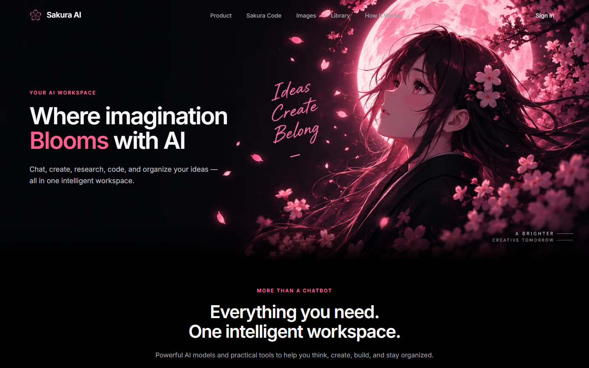
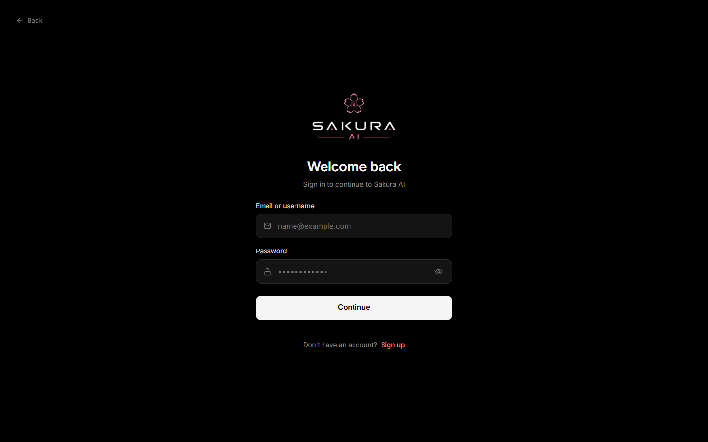
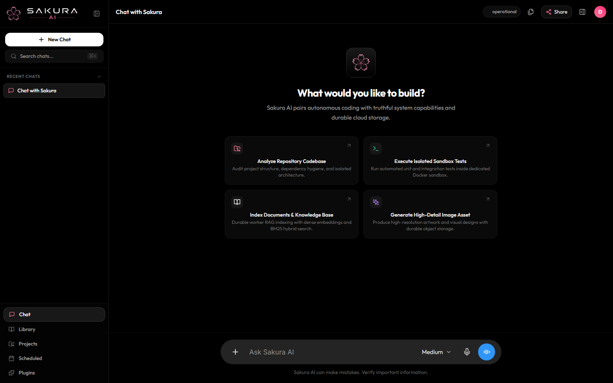
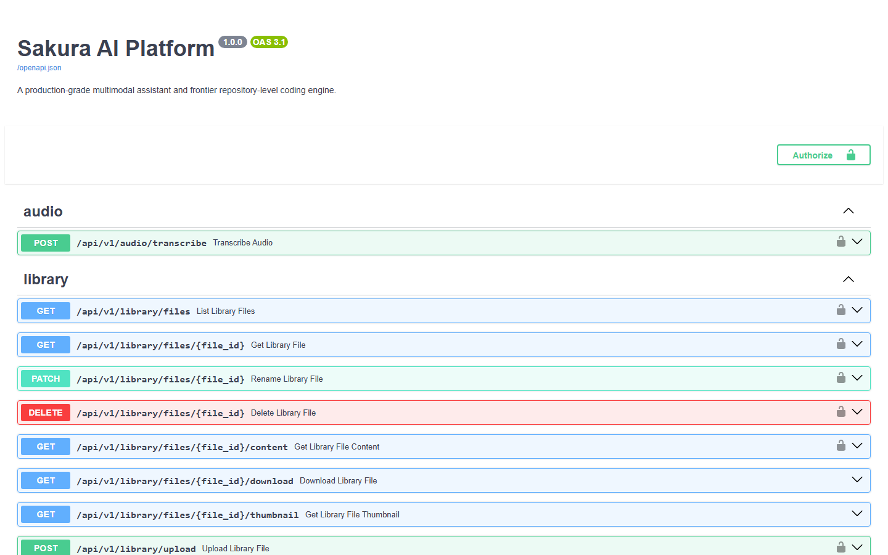
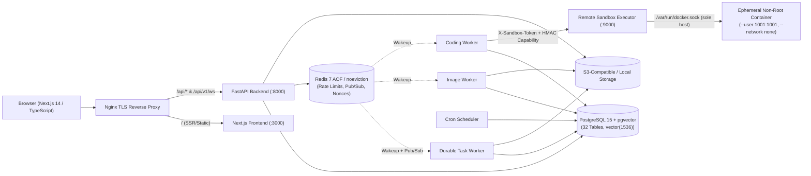

# Sakura AI

**A Full-Stack Multi-Agent AI Workspace featuring Hybrid Semantic RAG (`pgvector` + Okapi BM25), Durable Multi-Worker Orchestration, Multimodal Library & Image Generation, and an Isolated Remote Docker Coding Engine.**

Sakura AI is a production-oriented full-stack AI platform built with **FastAPI (Python 3.11+)**, **Next.js 14 (React 18 / TypeScript)**, **PostgreSQL 15 + `pgvector` (`vector(1536)`)**, **Redis 7**, and an **isolated remote Docker sandbox executor**. Designed for both **academic evaluation** and **production systems engineering**, it goes well beyond a single chat wrapper by implementing 32 normalized relational tables, 11 sequential Alembic migrations, database-authoritative background workers with lease fencing, strict multi-tenant authorization, asynchronous S3-compatible object deletion, idempotent image generation with daily quotas, and non-root container execution for autonomous repository coding.

---

## Documentation & Academic Deliverables

| Deliverable | Audience | Contents |
| --- | --- | --- |
| [`docs/academic/PROJECT_REPORT.md`](docs/academic/PROJECT_REPORT.md) | College Evaluators & Faculty | Complete 12-chapter academic major-project report (Introduction, Existing vs Proposed, Requirements, Architecture, Stack, 14 Modules, 32-Table DB, Implementation, Security, Verified Testing, Limitations, Conclusion) |
| [`docs/academic/`](docs/academic/) | Academic Submission | Standalone [`ABSTRACT.md`](docs/academic/ABSTRACT.md), [`PROBLEM_STATEMENT.md`](docs/academic/PROBLEM_STATEMENT.md), [`REQUIREMENTS_SPECIFICATION.md`](docs/academic/REQUIREMENTS_SPECIFICATION.md), [`MODULE_DOCUMENTATION.md`](docs/academic/MODULE_DOCUMENTATION.md), [`TESTING_DOCUMENTATION.md`](docs/academic/TESTING_DOCUMENTATION.md), [`LIMITATIONS_AND_FUTURE_SCOPE.md`](docs/academic/LIMITATIONS_AND_FUTURE_SCOPE.md) |
| [`docs/architecture/`](docs/architecture/) | Architects & Faculty | All 9 verified Mermaid diagrams: [`SYSTEM_ARCHITECTURE.md`](docs/architecture/SYSTEM_ARCHITECTURE.md), [`API_WORKFLOW.md`](docs/architecture/API_WORKFLOW.md), [`AI_RAG_WORKFLOW.md`](docs/architecture/AI_RAG_WORKFLOW.md), [`DATABASE_ER_DIAGRAM.md`](docs/architecture/DATABASE_ER_DIAGRAM.md), [`CODING_SANDBOX_WORKFLOW.md`](docs/architecture/CODING_SANDBOX_WORKFLOW.md) |
| [`presentation/`](presentation/) | College Viva & Presentation | Editable 19-slide source ([`SLIDES_SOURCE.md`](presentation/SLIDES_SOURCE.md), [`build_presentation.py`](presentation/build_presentation.py)) and final PowerPoint deck ([`Sakura_AI_Academic_Presentation.pptx`](presentation/Sakura_AI_Academic_Presentation.pptx)) |
| [`docs/interview/`](docs/interview/) | Viva & Engineering Interviews | [`VIVA_QUESTIONS_AND_ANSWERS.md`](docs/interview/VIVA_QUESTIONS_AND_ANSWERS.md) (50 viva Q&As + 8 senior deep-dives), [`ARCHITECTURE_EXPLANATIONS.md`](docs/interview/ARCHITECTURE_EXPLANATIONS.md), [`TECHNICAL_INTERVIEW_PREP.md`](docs/interview/TECHNICAL_INTERVIEW_PREP.md) |
| [`docs/DEMO_PLAYBOOK.md`](docs/DEMO_PLAYBOOK.md) | Live Demonstrations | Repeatable 15-minute live demo script with pre-flight checklist and offline/degraded fallback matrix |
| [`anime-ai/PRODUCTION_READINESS.md`](anime-ai/PRODUCTION_READINESS.md) | DevOps & Release Reviewers | Staging runbook, branch protection, backup/restore verification, and operational readiness checklist |
| [`anime-ai/SAKURA_CODING_ENGINE.md`](anime-ai/SAKURA_CODING_ENGINE.md) | Engineering Reference | Coding agent design charter, 21-tool surface, and verification principles |

---

## Feature Overview

- **Multi-Provider Conversational AI & Streaming (SSE):** Provider-neutral routing across **Groq**, **OpenAI**, **Anthropic**, and local **Ollama** (`local_private` / `private_data` intents fail closed via `PrivateModelUnavailableError` without leaking prompts to cloud providers), with persistent conversations, pinning, archiving, search, shareable links (`/share/{token}`), message feedback, and long-term memory.
- **Hybrid Retrieval-Augmented Generation (RAG):** Asynchronous document parsing (`pdfplumber` for PDFs; UTF-8 for Markdown, TXT, and source code) into overlapping 800-char/150-overlap chunks, native PostgreSQL `pgvector` (`vector(1536)`) cosine similarity fused with Okapi BM25 (`k1=1.5`, `b=0.75`) via Reciprocal Rank Fusion (RRF), generation-fenced re-indexing, and honest BM25 fallback when `OPENAI_API_KEY` is unset.
- **Sakura Code (Autonomous Repository Coding Engine):** Durable coding jobs claimed by a standalone `coding-worker` against an isolated HTTP `sandbox-executor` service running ephemeral, non-root (`UID 1001:1001`) Docker containers with `--network none` by default, `--cap-drop ALL`, `2.0` CPUs / `512 MB` RAM / `64` PID caps, single-workspace mounts, live SSE replay (`after_sequence`), and single-use HMAC-SHA256 network capability tokens.
- **Durable Multi-Worker Architecture:** Four decoupled background processes—`worker` (documents, summaries, ZIP exports, storage outbox), `image-worker` (raster generation & idempotent variations), `coding-worker` (repository coding tasks), and `scheduler` (IANA timezone-aware cron dispatch)—coordinated via PostgreSQL `FOR UPDATE SKIP LOCKED` / CAS claims and unexpired-lease fencing.
- **Library, Multimodal Images & Voice:** Pluggable `StorageBackend` (`LocalFilesystemStorage` and streaming `S3CompatibleStorage`), header-only Bearer file downloads and Blob previews (`?token=` rejected `401`), asynchronous `HTTP 202` deletion via `StorageDeletionOutbox` + killable subprocess runner, idempotent image variations (`HTTP 400`/`202`/`409`), and Whisper audio transcription (25 MB cap).
- **Security, Quotas & Account Governance:** `PyJWT` (`HS256`) authentication, single-use 60-second WebSocket tickets, Redis-backed fail-closed auth rate limits with CIDR-validated proxy headers, atomic UTC-day per-user quotas (`chat: 500`, `image_generation: 50`, `coding_task: 50`, `file_upload: 100`, `scheduled_job: 30`), transactional SMTP password reset, async ZIP export, and audited self-service account deletion.

---

## Application Screenshots

> Captured directly from the live running Next.js (`http://localhost:3000`) and FastAPI (`http://127.0.0.1:8000`) stack.

| Landing Page (`/`) | Authentication (`/login`) |
| --- | --- |
|  |  |

| Authenticated Workspace (`/chat`) | FastAPI OpenAPI Docs (`/docs`) |
| --- | --- |
|  |  |

---

## Architecture Overview

See [`docs/architecture/`](docs/architecture/) for all 9 detailed Mermaid blueprints (Overall Architecture, API Communication, Auth Lifecycle, AI Routing, Hybrid RAG, 32-Table ER Diagram, Durable Worker Lease Fencing, Sakura Coding Engine, and Docker Sandbox Isolation).



---

## Technology Stack

| Layer | Technologies |
| --- | --- |
| **Frontend** | Next.js 14 (`images.unoptimized: true`), React 18, TypeScript 5, Tailwind CSS, Framer Motion, Lucide Icons, Playwright E2E |
| **Backend API & Workers** | Python 3.11+, FastAPI, Uvicorn, SQLAlchemy 2, Alembic (11 migrations), Pydantic v2, PyJWT (`HS256`), Passlib (`pbkdf2_sha256`), HTTPX |
| **Database & Search** | PostgreSQL 15, `pgvector` (`vector(1536)`), Okapi BM25 (`k1=1.5`, `b=0.75`) + Reciprocal Rank Fusion, `pdfplumber` (SQLite local dev parity) |
| **Queue, Realtime & Storage** | Redis 7 (AOF + `noeviction`), WebSocket Pub/Sub, Boto3 S3-compatible / Local FS |
| **AI & Media** | Groq API, OpenAI SDK (chat, `text-embedding-3-small`, Whisper STT), Anthropic SDK, Local Ollama, Pollinations raster pipeline, Tavily / DuckDuckGo |
| **Execution & DevOps** | Docker, Docker Compose (`docker-compose.prod.yml`), Nginx TLS config, GitHub Actions CI (4 required workflows) |

---

## Repository Structure

```text
Sakura-AI/
├── .github/workflows/ci.yml              # 4 required CI jobs: PG15+Backend, Frontend+Playwright, Docker Sandbox E2E, Full-Stack E2E
├── docs/
│   ├── academic/                         # 12-chapter PROJECT_REPORT.md + standalone abstract, SRS, modules, testing, limitations
│   ├── architecture/                     # 9 Mermaid architecture, ER (32 tables), API, AI/RAG, worker & sandbox diagrams
│   ├── assets/screenshots/               # Live application screenshots
│   ├── interview/                        # 50 viva Q&As + 8 senior deep-dives, whiteboard explanations, interview prep
│   └── DEMO_PLAYBOOK.md                  # Repeatable 15-minute live presentation & fallback plan
├── presentation/
│   ├── SLIDES_SOURCE.md                  # Editable 19-slide presentation source
│   ├── build_presentation.py             # Reproducible python-pptx + Pillow deck generator
│   └── Sakura_AI_Academic_Presentation.pptx
├── README.md                             # Repository overview (this file)
└── anime-ai/
    ├── PRODUCTION_READINESS.md           # Staging/production runbook & release governance
    ├── SAKURA_CODING_ENGINE.md           # Coding agent design charter & 21-tool specification
    ├── docker-compose.prod.yml           # 10-service production topology with healthchecks
    ├── ops/
    │   ├── nginx.conf.example            # TLS 1.2/1.3 reverse proxy, WS upgrade, unbuffered SSE
    │   └── scripts/                      # validate_env.py, backup_postgres.sh, verify_restore.sh
    ├── sandbox/                          # Non-root (UID 1001) coding sandbox Dockerfile
    ├── backend/
    │   ├── main.py                       # FastAPI app, X-Request-ID middleware, /health, deep /readiness
    │   ├── alembic/                      # 11 migrations (8936a43c2fb5 -> j9f7a263b56c pgvector vector(1536))
    │   ├── api/                          # routes, library, coding, scheduled, projects, integrations, audio, capabilities
    │   ├── auth/                         # PyJWT manager, Fernet secret crypto, tenant authorization guards
    │   ├── coding/                       # Agent, 21-tool toolchain, sandbox runtime, sandbox_service, HMAC capabilities, job_worker
    │   ├── config/                       # Fail-closed production security guards & settings
    │   ├── database/                     # 32 SQLAlchemy ORM models & dialect-aware Vector(1536)
    │   ├── llm/                          # Intent-based provider router & OpenAI/Anthropic/Groq/Ollama adapters
    │   ├── media/                        # Durable image worker & Pollinations raster router
    │   ├── memory/                       # Long-term semantic memory manager
    │   ├── rag/                          # pdfplumber parser, OpenAI embedding manager, hybrid pgvector+BM25 RRF retriever
    │   ├── realtime/                     # Single-use ticket WebSocket hub + Redis Pub/Sub
    │   ├── services/                     # documents, storage_delete_runner, storage, quotas, rate_limit, account, email, web_search
    │   ├── tasks/                        # Durable task worker, task manager, timezone cron scheduler
    │   └── tests/                        # 271 unit, security, concurrency, schema parity, PG15 & Docker E2E tests
    └── frontend/
        ├── pages/                        # /, /login, /chat, /console, /share/[token], /about, /features, /privacy, /terms, /contact
        ├── components/                   # LibraryView, FilePreviewModal, AuthenticatedImage, coding/*, app/*, landing/*
        ├── hooks/                        # useRealtime, useTasks, useCodingTaskStream
        ├── lib/                          # API URL resolution, authFetch, idempotency helpers
        └── tests/                        # Mocked & unmocked full-stack Playwright E2E specs
```

---

## Installation, Environment & Database Setup

### Prerequisites
- **Local Development:** Python 3.11+, Node.js 20/22 LTS + `npm`.
- **Full Containerized Production Parity:** Docker Engine + Docker Compose v2, PostgreSQL 15 (`pgvector/pgvector:pg15`), Redis 7.

### 1. Backend Installation & Database Migration (Local SQLite Dev)

```bash
cd anime-ai/backend
python -m venv venv
# Windows PowerShell: .\venv\Scripts\Activate.ps1
# Linux/macOS: source venv/bin/activate
pip install -r requirements.txt
```

Create `anime-ai/backend/.env` (**never commit `.env` files or secrets to Git**):

```env
ENVIRONMENT=development
DATABASE_URL=sqlite:///./anime_ai.db
JWT_SECRET=replace-with-a-random-local-dev-secret-at-least-32-chars
# Configure at least one LLM provider for live chat:
GROQ_API_KEY=
OPENAI_API_KEY=
ANTHROPIC_API_KEY=
# Optional local private LLM & web search:
OLLAMA_BASE_URL=
TAVILY_API_KEY=
```

Apply all 11 Alembic migrations (`j9f7a263b56c`) and start the FastAPI server:

```bash
python -m alembic upgrade head
python -m uvicorn main:app --host 127.0.0.1 --port 8000 --reload
```

### 2. Frontend Installation & Development Server

```bash
cd anime-ai/frontend
npm ci
# Windows PowerShell:
$env:SAKURA_API_PROXY_TARGET="http://127.0.0.1:8000"
$env:NEXT_PUBLIC_API_URL="http://127.0.0.1:8000"
npm run dev
```

Open **http://localhost:3000** (Interactive OpenAPI docs at **http://127.0.0.1:8000/docs**).

### 3. Docker Production-Topology Setup (PostgreSQL 15 + `pgvector` + Redis 7 + Sandbox)

Inject independent high-entropy secrets (`>= 32` characters each) via your secret manager or `.env.prod` (excluded from Git), validate fail-closed production requirements, and launch the full topology:

```bash
python anime-ai/ops/scripts/validate_env.py
docker compose -f anime-ai/docker-compose.prod.yml config -q
docker compose -f anime-ai/docker-compose.prod.yml up -d --build
```

Required production variables include `POSTGRES_PASSWORD`, `DATABASE_URL` (`postgresql+psycopg2://...`), `REDIS_URL`, `JWT_SECRET`, `INTEGRATION_ENCRYPTION_KEY`, `SAKURA_SANDBOX_SERVICE_TOKEN`, `SAKURA_SANDBOX_CAPABILITY_SIGNING_KEY`, `SAKURA_STORAGE_BACKEND=s3` (+ bucket/credentials), `CORS_ALLOWED_ORIGINS`, `TRUSTED_PROXY_CIDRS`, and `SAKURA_EMBEDDED_*=false`. Backup and restore scripts are located at `anime-ai/ops/scripts/backup_postgres.sh` and `verify_restore.sh`.

---

## Testing & CI Verification

### Local Backend Compilation & Unit/Security Suite
```bash
cd anime-ai/backend
python -m compileall -q . ../ops/scripts
DATABASE_URL=sqlite:///./tmp_test.db ENVIRONMENT=development python -m unittest discover -s tests -p "test_*.py" -v
```
*(Latest verified local run: **271 discovered -> 253 passed, 18 PostgreSQL/Docker-gated skipped, 0 failed**.)*

### Local Frontend Typecheck, Lint & Production Build
```bash
cd anime-ai/frontend
npm run typecheck
npm run lint
npm run build
```

### GitHub Actions CI (4 Required Workflows — Run `46157049085` on `d8de865`: 4/4 PASSED)
Every pull request executes four required Ubuntu Linux CI workflows in [`.github/workflows/ci.yml`](.github/workflows/ci.yml):
1. **Backend Tests & Schema Verification:** Real PostgreSQL 15 (`pgvector/pgvector:pg15`) + Redis 7, Alembic upgrade, 32-table schema parity, PG concurrency & `pgvector(1536)` tests (`0` skips), official `postgres:15` `backup_postgres.sh` + `verify_restore.sh` (positive restore + tampered `.sha256` rejection), Compose validation, and backend Docker build.
2. **Frontend Typecheck & Build:** `tsc --noEmit`, `next lint`, `next build`, Playwright landing smoke tests, and production frontend Docker build.
3. **Docker Sandbox E2E Integration:** Builds `sakura-sandbox`, `sakura-sandbox-executor`, and `sakura-backend`; verifies non-root `1001:1001` execution, `--network none`, single-use HMAC capabilities, and **0 orphaned `sakura-exec-*` containers**.
4. **Full-Stack Integration Tests:** Runs PG15 + Redis 7 + remote Docker executor + FastAPI API + 3 separate worker containers + Next.js frontend and runs unmocked Playwright browser E2E with **0 orphaned containers**.

---

## Security Highlights

- **Strict Multi-Tenant Isolation:** Every tenant resource enforces `user_id` ownership (`404` on cross-user access; `400` on malformed UUIDs); storage keys are strictly prefixed `users/<user_id>/...`.
- **Zero Secrets in URLs:** `PyJWT` (`HS256`) tokens are sent strictly via `Authorization: Bearer` headers (`?token=` downloads rejected with `HTTP 401`); WebSockets authenticate via single-use 60-second tickets (`POST /api/v1/auth/ws-ticket`).
- **Fail-Closed Production Guards:** Startup and `/readiness` reject missing, default, short (`< 32` chars), or reused secrets, reject wildcard CORS, fail closed (`HTTP 503`) on auth rate limits if Redis is unavailable, and block forged internal task types (`HTTP 400`).
- **Defense-in-Depth Sandbox & Frontend Hardening:** Dedicated `sandbox-executor` isolates `/var/run/docker.sock`; child containers run as non-root `1001:1001` with `--network none`, `--cap-drop ALL`, `no-new-privileges:true`, CPU/RAM/PID caps, and allowlisted env vars; frontend disables `/_next/image` via `images.unoptimized: true`.

---

## Known Limitations & Roadmap

### Verified Known Limitations
- **No Externally Provisioned Staging Host Yet:** External TLS/DNS, managed PostgreSQL 15, Redis 7, S3 bucket credentials, and SMTP delivery must be provisioned before public launch.
- **Next.js 14 -> 16 Upgrade Pending:** Frontend currently runs `next@14.2.35` (`images.unoptimized: true` mitigates `/_next/image` advisories immediately); upgrading to Next.js 16 + React 19 is planned as a dedicated post-merge PR.
- **Partial Third-Party Connectors:** GitHub integration is implemented with Fernet-encrypted token storage and live API verification; Google Drive, Notion, Slack, Jira, and Postgres connectors intentionally return `HTTP 501 Not Implemented`.
- **Prompt-Context Image Edits:** Image variations and edits use prompt-context regeneration (`image_conditioned_edit: false`, `true_upscale: false` truthfully reported by `/api/v1/capabilities`).
- **Legal Drafts:** `/privacy` and `/terms` are pre-launch drafts requiring formal legal review prior to commercial release.

### Roadmap
1. Merge PR `#1` after independent review and deploy to a controlled private staging host with live backup/restore & load testing.
2. Complete Next.js 14 -> 16 (React 19) migration, resolve the 10 pre-existing non-blocking ESLint warnings, and add `pip-audit` / `npm audit` CI gates.
3. Add local open-source embedding support, `pgvector` HNSW indexes, and PostgreSQL `tsvector` lexical scaling.
4. Evaluate Firecracker / gVisor (`runsc`) microVM isolation for public multi-tenant coding execution and wire Prometheus/OpenTelemetry metrics.
