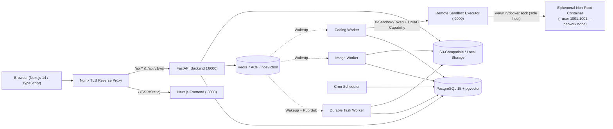

# Sakura AI

**A Full-Stack Multi-Agent AI Workspace featuring Hybrid Semantic RAG (`pgvector` + Okapi BM25), Durable Multi-Worker Orchestration, Multimodal Library & Image Generation, and an Isolated Remote Docker Coding Engine.**

Sakura AI is a production-oriented full-stack AI platform built with **FastAPI**, **Next.js (TypeScript)**, **PostgreSQL 15 + `pgvector`**, **Redis 7**, and an **isolated Docker sandbox executor**. Rather than wrapping a single chat completion endpoint, it implements the durable systems engineering required for multi-user AI workloads: database-authoritative background queues with lease fencing, strict multi-tenant authorization, asynchronous S3-compatible object storage deletion, idempotent image generation with daily quotas, and non-root container execution for autonomous coding tasks.

---

## Documentation Suite

| Document | Audience | Contents |
| --- | --- | --- |
| [`docs/ACADEMIC_PROJECT_REPORT.md`](docs/ACADEMIC_PROJECT_REPORT.md) | College Evaluators & Faculty | Abstract, problem statement, objectives, Mermaid architecture/ER/workflow diagrams, module specs, security analysis, verified test results |
| [`docs/INTERVIEW_GUIDE.md`](docs/INTERVIEW_GUIDE.md) | Recruiters & Technical Interviewers | Architecture rationale, distributed-systems trade-offs, failure modes, and 15 deep-dive technical Q&As |
| [`docs/DEMO_PLAYBOOK.md`](docs/DEMO_PLAYBOOK.md) | Live Demonstrations & Viva | Step-by-step 15-minute demo script, pre-flight checks, and offline/degraded fallback plan |
| [`anime-ai/PRODUCTION_READINESS.md`](anime-ai/PRODUCTION_READINESS.md) | DevOps & Release Reviewers | Production runbook, branch protection, backup/restore verification, and controlled staging checklist |
| [`anime-ai/SAKURA_CODING_ENGINE.md`](anime-ai/SAKURA_CODING_ENGINE.md) | Engineering Reference | Coding agent design charter, 21-tool surface, and verification principles |

---

## Core Features

- **Multi-Provider Conversational AI & Streaming (SSE):** Provider-neutral routing across OpenAI, Anthropic, Groq (with automatic model fallback), and local Ollama (`private` mode fails closed without leaking prompts to cloud providers), with persistent conversation history, memory extraction, and shareable links.
- **Hybrid Retrieval-Augmented Generation (RAG):** Document ingestion (`PDF`, `TXT`, `MD`, `CSV`, code files) backed by native PostgreSQL `pgvector` (`vector(1536)`) cosine similarity fused with Okapi BM25 lexical scoring via Reciprocal Rank Fusion (RRF), strictly scoped per user.
- **Sakura Code (Autonomous Coding Engine):** Durable coding jobs executed by a dedicated `coding-worker` against an isolated HTTP `sandbox-executor` service running ephemeral, non-root (`1001:1001`) Docker containers with `--network none` by default, `--cap-drop ALL`, CPU/memory/PID caps, single-workspace mounts, and single-use HMAC-signed capability tokens.
- **Durable Multi-Worker Architecture:** Separate `worker` (documents, scheduled runs, exports, outbox deletions), `image-worker` (image generation & idempotent variations), `coding-worker` (repository coding tasks), and `scheduler` (IANA timezone-aware cron dispatch) using PostgreSQL `FOR UPDATE SKIP LOCKED` / conditional CAS claims and unexpired-lease fencing.
- **Library & Multimodal Media Pipeline:** Pluggable `StorageBackend` (`LocalFilesystemStorage` and streaming `S3CompatibleStorage`), authenticated Blob-based image previews and file downloads (header-only `Authorization: Bearer`, no JWTs in URLs), asynchronous `HTTP 202` document deletion via `StorageDeletionOutbox` + killable subprocess runner, and idempotent image generation/variations (`HTTP 400` / `202` / `409`).
- **Security & Account Lifecycle:** `PyJWT` (`HS256`) authentication, single-use WebSocket tickets, Redis-backed fail-closed auth rate limiting, atomic UTC-day per-user quotas (`user_usage_quotas`), transactional SMTP password reset, async ZIP user-data export, and self-service account deletion with audit logging.

---

## High-Level Architecture



---

## Technology Stack

| Layer | Technologies |
| --- | --- |
| **Frontend** | Next.js 14, React 18, TypeScript 5, Tailwind CSS, Framer Motion, Lucide Icons, Playwright E2E |
| **Backend API & Workers** | Python 3.11+, FastAPI, Uvicorn, SQLAlchemy 2, Alembic, Pydantic v2, PyJWT, Passlib (`pbkdf2_sha256`), HTTPX |
| **Database & Search** | PostgreSQL 15, `pgvector` (`vector(1536)`), Okapi BM25 + Reciprocal Rank Fusion (SQLite supported for local dev) |
| **Queue, Realtime & Storage** | Redis 7 (AOF + `noeviction`, Pub/Sub, rate-limit sliding window, capability nonce store), Boto3 S3-compatible / Local FS |
| **AI & Media** | OpenAI SDK, Anthropic SDK, Groq API, Ollama (local), Tavily / DuckDuckGo search, Pollinations raster pipeline |
| **Execution & DevOps** | Docker, Docker Compose (`docker-compose.prod.yml`), Nginx TLS config, GitHub Actions CI (4 required workflows) |

---

## Repository Structure

```text
Sakura-AI/
├── .github/workflows/ci.yml           # 4-job CI: Backend+PG15, Frontend+Playwright, Docker Sandbox E2E, Full-Stack E2E
├── docs/
│   ├── ACADEMIC_PROJECT_REPORT.md     # Formal academic documentation & Mermaid diagrams
│   ├── INTERVIEW_GUIDE.md             # System design rationale & technical interview Q&As
│   └── DEMO_PLAYBOOK.md               # Repeatable live presentation & fallback plan
├── README.md                          # Repository overview (this file)
└── anime-ai/
    ├── PRODUCTION_READINESS.md        # Staging/production ops runbook & evidence matrix
    ├── SAKURA_CODING_ENGINE.md        # Coding agent specification & principles
    ├── docker-compose.prod.yml        # 10-service production topology with healthchecks
    ├── ops/
    │   ├── nginx.conf.example         # TLS 1.2/1.3 reverse proxy, WS upgrade, unbuffered SSE
    │   └── scripts/                   # validate_env.py, backup_postgres.sh, verify_restore.sh
    ├── sandbox/                       # Non-root (UID 1001) sandbox container Dockerfile
    ├── backend/
    │   ├── main.py                    # FastAPI app, /health, deep /readiness probe
    │   ├── alembic/                   # Schema migrations (through pgvector vector(1536))
    │   ├── api/                       # routes, library, coding, scheduled, projects, integrations, audio, capabilities
    │   ├── auth/                      # PyJWT auth manager, Fernet secret crypto, IDOR guards
    │   ├── coding/                    # Agent, toolchain, sandbox runtime, sandbox_service, capabilities, job_worker
    │   ├── config/                    # Production security guards & environment settings
    │   ├── database/                  # SQLAlchemy models & connection pooling
    │   ├── llm/                       # Provider router & OpenAI/Anthropic/Groq/Ollama adapters
    │   ├── media/                     # Durable image worker & raster generation router
    │   ├── memory/                    # Long-term semantic memory manager
    │   ├── rag/                       # Document parser, embedding manager, hybrid RRF retriever
    │   ├── realtime/                  # Multi-worker Redis Pub/Sub WebSocket manager
    │   ├── services/                  # documents, outbox runner, storage, quotas, rate_limit, account, email
    │   ├── tasks/                     # Durable task worker, task manager, cron scheduler
    │   └── tests/                     # 250+ unit, concurrency, security, subprocess, PG & Docker E2E tests
    └── frontend/
        ├── pages/                     # Landing, /login, /chat, /console, /share/[token], legal & contact pages
        ├── components/                # LibraryView, FilePreviewModal, AuthenticatedImage, ConversationFilesSheet, etc.
        ├── hooks/                     # useRealtime, useTasks, useCodingTaskStream
        ├── lib/                       # authFetch, API routing, idempotency helpers
        └── tests/                     # Mocked & unmocked full-stack Playwright E2E specs
```

---

## Local Development Setup

### Prerequisites
- Python 3.11+
- Node.js 20+ (and `npm`)
- Optional for full production parity: Docker Desktop / Docker Engine, PostgreSQL 15 (`pgvector`), Redis 7

### 1. Backend Setup

```bash
cd anime-ai/backend
python -m venv venv
# Windows PowerShell: .\venv\Scripts\Activate.ps1
# Linux/macOS: source venv/bin/activate
pip install -r requirements.txt
```

Create `anime-ai/backend/.env` (never commit `.env` files to Git):

```env
ENVIRONMENT=development
DATABASE_URL=sqlite:///./anime_ai.db
JWT_SECRET=replace-with-a-random-local-dev-secret-at-least-32-chars
# Configure at least one LLM provider:
GROQ_API_KEY=
OPENAI_API_KEY=
ANTHROPIC_API_KEY=
# Optional web search & embeddings:
TAVILY_API_KEY=
```

Apply database migrations and start the API server:

```bash
python -m alembic upgrade head
python -m uvicorn main:app --host 127.0.0.1 --port 8000 --reload
```

### 2. Frontend Setup

```bash
cd anime-ai/frontend
npm ci
# Windows PowerShell:
$env:SAKURA_API_PROXY_TARGET="http://127.0.0.1:8000"
$env:NEXT_PUBLIC_API_URL="http://127.0.0.1:8000"
npm run dev
```

Open **http://localhost:3000** (API docs at **http://127.0.0.1:8000/docs**).

### 3. Production / Staging Environment Configuration

Before running `docker compose -f anime-ai/docker-compose.prod.yml up`, inject independent high-entropy secrets via your secret manager and validate with:

```bash
python anime-ai/ops/scripts/validate_env.py
```

Required production variables include `POSTGRES_PASSWORD`, `DATABASE_URL` (`postgresql+psycopg2://...`), `REDIS_URL`, `JWT_SECRET`, `INTEGRATION_ENCRYPTION_KEY`, `SAKURA_SANDBOX_SERVICE_TOKEN`, `SAKURA_SANDBOX_CAPABILITY_SIGNING_KEY`, `SAKURA_STORAGE_BACKEND=s3` (+ bucket/credentials), `CORS_ALLOWED_ORIGINS`, `TRUSTED_PROXY_CIDRS`, and `SAKURA_EMBEDDED_*=false`. See [`anime-ai/PRODUCTION_READINESS.md`](anime-ai/PRODUCTION_READINESS.md) for the complete reference.

---

## Testing & Verification

### Backend Unit & Security Regression Suite
```bash
cd anime-ai/backend
python -m compileall -q . ../ops/scripts
DATABASE_URL=sqlite:///./tmp_test.db ENVIRONMENT=test SAKURA_EMBEDDED_WORKER=false SAKURA_EMBEDDED_SCHEDULER=false SAKURA_EMBEDDED_CODING_WORKER=false python -m unittest discover -s tests -p "test_*.py" -v
```

### Frontend Typecheck, Lint & Build
```bash
cd anime-ai/frontend
npm run typecheck
npm run lint
npm run build
```

### GitHub Actions CI (Real PostgreSQL 15 + `pgvector`, Redis 7, Docker Sandbox & Playwright)
Every PR runs four required Linux CI jobs defined in [`.github/workflows/ci.yml`](.github/workflows/ci.yml):
1. **Backend Tests & Schema Verification:** Real PostgreSQL 15 (`pgvector/pgvector:pg15`) + Redis 7, Alembic upgrade, schema parity, PG concurrency & `pgvector` tests (0 skips), official `postgres:15` `backup_postgres.sh` + `verify_restore.sh` (positive + tampered-checksum negative checks), Compose config validation, backend Docker build, and full backend suite.
2. **Frontend Typecheck & Build:** `tsc --noEmit`, `next lint`, `next build`, Playwright Chromium browser E2E, and frontend Docker build.
3. **Docker Sandbox E2E Integration:** Builds `sakura-sandbox`, `sakura-sandbox-executor`, and `sakura-backend`; verifies remote Docker execution, shared workspace ownership (`1001:1001`), network isolation, capability verification, and `0` orphaned sandbox containers.
4. **Full-Stack Integration Tests:** Runs PG 15 + Redis + remote Docker executor + FastAPI API + 3 separate worker containers + Next.js frontend and executes unmocked Playwright browser E2E with `0` orphaned containers.

---

## Security Highlights

- **Strict Multi-Tenant Isolation:** Every conversation, document, chunk, image, project, scheduled task, coding task, and storage key (`users/<user_id>/...`) enforces ownership checks; cross-user requests fail closed (`404` / `400`).
- **No Secrets in URLs:** WebSocket connections require short-lived single-use tickets (`POST /api/v1/auth/ws-ticket`); file downloads and thumbnails enforce header-only `Authorization: Bearer` authentication (`?token=` rejected with `401`).
- **Fail-Closed Production Guards:** Production startup and `/readiness` refuse weak, missing, default, or reused secrets, reject wildcard `CORS_ALLOWED_ORIGINS`, refuse Redis outages on auth rate limits and capability nonce verification (`503`/denied), and refuse host-execution fallbacks when remote sandbox execution is unavailable.
- **Container Hardening:** Child coding containers execute as non-root `1001:1001` with `--network none` by default, `--cap-drop ALL`, `no-new-privileges:true`, strict allowlisted child environment variables, and kill-before-remove cleanup.

---

## Known Limitations & Roadmap

### Current Known Limitations (Verified Honestly)
- **No Live Public Deployment Yet:** Staging infrastructure (dedicated hardened `sandbox-executor` host, managed PG 15, Redis 7, S3 bucket, live SMTP, TLS/Nginx) must be provisioned externally before public launch.
- **Frontend Framework Upgrade Pending:** The frontend currently runs on `next@14.2.35` (`images.unoptimized: true` is enabled to disable the unused `/_next/image` endpoint); upgrading to Next.js 16 + React 19 is planned as a dedicated post-merge PR to clear upstream `npm audit` advisories.
- **Unimplemented Third-Party Connectors:** GitHub integration is implemented with real API verification; Google Drive, Notion, Slack, direct Postgres, and Jira connectors intentionally return `HTTP 501 Not Implemented` rather than stubbing fake connections.
- **Image Conditioning:** Image variations are prompt-context regenerations rather than pixel-level inpainting (`image_conditioned_edit: false`, `true_upscale: false` reported truthfully by `/api/v1/capabilities`).
- **Legal Drafts:** `/privacy` and `/terms` are pre-launch drafts requiring formal legal review prior to public commercial release.

### Roadmap
1. Merge PR `#1` after independent review and execute controlled private staging acceptance & load tests.
2. Upgrade Next.js 14 → 16 (React 19) and add automated `pip-audit` / `npm audit` dependency checks to CI.
3. Add object-age grace window to orphan storage sweep and expand OAuth/connector adapters.
4. Wire live Prometheus/OpenTelemetry metrics and alerting for multi-replica production operations.
