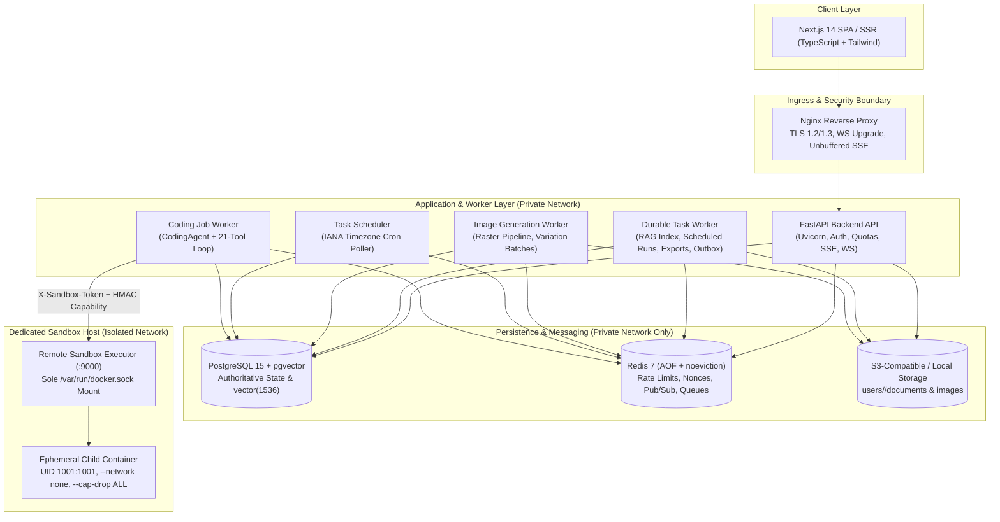
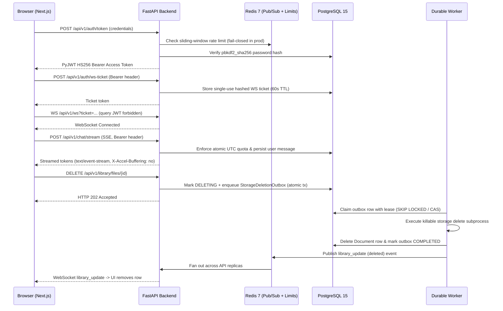
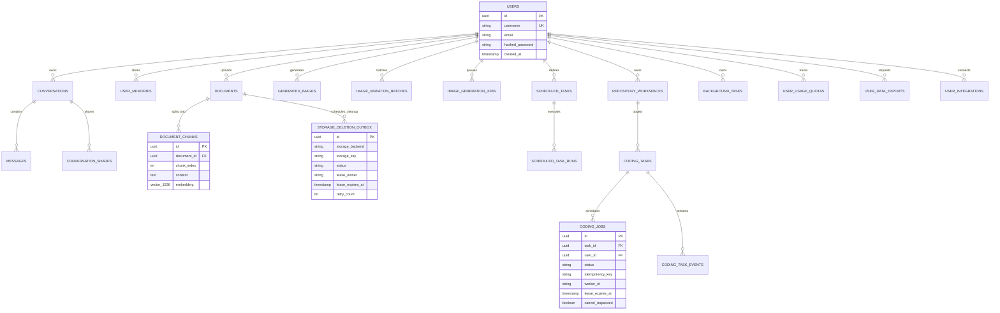
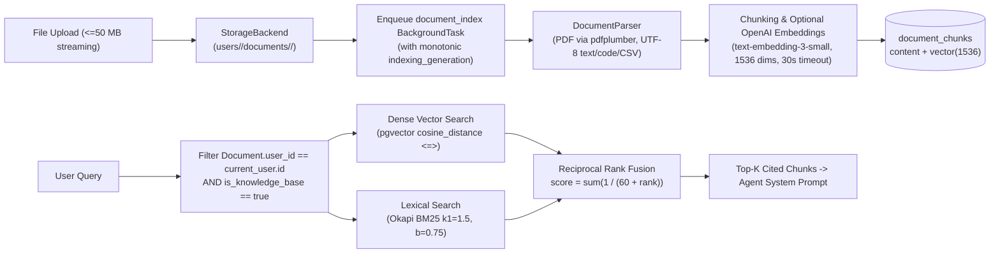
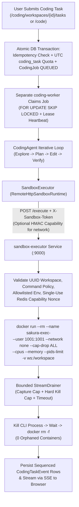

# Sakura AI — Academic Project Technical Report

> **Document Purpose:** Formal college major-project evaluation & technical architecture report.  
> **Evidence Standard:** All architectural descriptions, database schemas, security controls, and test outcomes in this report reflect the actual verified codebase and CI runs. No synthetic benchmarks or unexecuted live-production results are claimed.

---

## 1. Project Metadata

- **Project Title:** Sakura AI — A Resilient Full-Stack Multi-Agent AI Platform with Hybrid Semantic RAG, Durable Multi-Worker Orchestration, and Isolated Remote Sandbox Execution
- **Repository:** https://github.com/Abhiram-C-Divakaran/Sakura-AI
- **Primary Technology Domains:** Full-Stack Web Engineering, Distributed Systems, Retrieval-Augmented Generation (RAG), Applied Cryptography & Application Security, Container Sandboxing

---

## 2. Abstract

Modern AI assistants frequently suffer from brittle monolithic designs: synchronous request handlers block on long-running inference or file deletions, document retrieval relies solely on either keyword search or unvalidated vector lookups, and autonomous code execution poses severe host-compromise risks when run inside application containers. **Sakura AI** addresses these challenges by implementing a multi-service, full-stack AI platform combining **Next.js (TypeScript)**, **FastAPI**, **PostgreSQL 15 with `pgvector`**, **Redis 7**, and a dedicated **Remote Docker Sandbox Executor**. The system enforces database-authoritative durable queues with lease fencing across separate task, image, and coding workers; hybrid semantic + Okapi BM25 retrieval fused via Reciprocal Rank Fusion (RRF); asynchronous S3-compatible storage deletion via a transactional outbox; idempotent media generation with atomic UTC-day quotas; and strict multi-tenant authorization with non-root container isolation. Automated verification spans 250+ backend tests and a four-job Linux CI pipeline executing real PostgreSQL 15 migrations, backup/restore drills, real remote Docker sandbox workflows, and unmocked Playwright full-stack browser tests.

---

## 3. Problem Statement

Existing student and prototype AI chat applications typically exhibit five structural weaknesses:
1. **Tightly Coupled Long-Running Work:** Document indexing, image generation, scheduled tasks, and code execution block HTTP threads or vanish when a server restarts.
2. **Data Consistency & Orphaned Storage:** Deleting database rows before external storage objects succeed leaves orphaned files, while blocking HTTP deletes on slow storage causes request timeouts.
3. **Weak Retrieval Quality & Tenant Leakage:** Naive prompt stuffing or unscoped vector queries miss exact technical keywords and risk exposing another user's documents.
4. **Unsafe Code Execution:** Allowing an AI coding agent to execute commands on the backend host risks secret exfiltration, filesystem traversal, and container escape.
5. **Fragile Security & Missing Operational Controls:** Hardcoded defaults, query-string JWT leakage, non-atomic quotas, and untested database backups prevent safe transition from prototype to staging.

---

## 4. Project Objectives

1. Design and build a cohesive full-stack AI workspace supporting multi-provider chat streaming, document intelligence (RAG), multimodal image generation, scheduled automation, and autonomous coding.
2. Guarantee durable background execution across multiple concurrent workers using PostgreSQL row locking, lease heartbeats, conditional compare-and-swap (CAS) recovery, and stale-worker fencing.
3. Implement Hybrid RAG combining PostgreSQL `pgvector` (`vector(1536)`) cosine similarity with Okapi BM25 lexical scoring via Reciprocal Rank Fusion, strictly isolated per user.
4. Isolate untrusted code execution inside ephemeral, non-root (`1001:1001`) Docker containers driven by a separate remote executor service enforcing `--network none` by default and single-use HMAC-signed capability tokens.
5. Enforce fail-closed production security controls, atomic per-user daily quotas, self-service account export/deletion, and reproducible PostgreSQL backup/restore verification.

---

## 5. Scope and Limitations

### In Scope (Implemented & Verified)
- Authenticated multi-user web platform (registration, `PyJWT` `HS256` login, SMTP password reset, account data export ZIP, self-service account deletion).
- Multi-provider LLM router (OpenAI, Anthropic, Groq, Ollama) with Server-Sent Events (SSE) streaming, bounded timeouts, and tool-calling agent loop.
- Document upload (up to 50 MB streaming), parsing, chunking, `pgvector` + BM25 Hybrid RAG, and asynchronous `HTTP 202` outbox-backed storage deletion.
- Durable image generation and idempotent variation batches with daily quotas.
- Cron/natural-language scheduled tasks with IANA timezone evaluation and atomic occurrence deduplication.
- Sakura Code durable coding jobs, 21-tool coding toolchain, sequenced event replay, and remote Docker sandbox execution.
- Automated 4-job GitHub Actions CI covering PostgreSQL 15, `pgvector`, Redis 7, Docker sandbox E2E, Playwright E2E, and backup/restore scripts.

### Explicitly Out of Scope / Current Limitations
- **External Staging Infrastructure:** Cloud hosting, dedicated sandbox-executor VM, managed S3 bucket, live SMTP relay, and live LLM billing keys are documented for manual operator provisioning rather than deployed publicly.
- **Unimplemented Third-Party Connectors:** GitHub PAT integration is implemented with live API verification; Google Drive, Notion, Slack, direct Postgres, and Jira intentionally return `HTTP 501 Not Implemented`.
- **Image Conditioning:** Image variations perform prompt-context regeneration rather than pixel-level inpainting (`image_conditioned_edit: false`).
- **Framework Upgrade & Legal Sign-Off:** Next.js 14 → 16 upgrade (to clear upstream `npm audit` advisories) and formal legal review of `/privacy` and `/terms` remain pre-public-launch gates.

---

## 6. Proposed Solution & System Architecture

### 6.1 High-Level System Architecture

### 6.2 Frontend / Backend Communication & Realtime Flow

### 6.3 Database Entity-Relationship (ER) Diagram

### 6.4 Hybrid AI / RAG Retrieval Workflow

### 6.5 Coding-Agent Remote Sandbox Execution Workflow

---

## 7. Technology Stack Summary

- **Frontend:** Next.js `14.2.35`, React 18, TypeScript 5, Tailwind CSS, Framer Motion, Lucide React, Playwright (`@playwright/test`).
- **Backend:** Python 3.11+, FastAPI, Uvicorn, SQLAlchemy 2.0, Alembic 1.13+, Pydantic v2, PyJWT (`HS256`), Passlib (`pbkdf2_sha256`), Cryptography (`Fernet`), HTTPX, Boto3, `pdfplumber`, `croniter`.
- **Data & Messaging:** PostgreSQL 15 (`pgvector/pgvector:pg15`), Redis 7 (`redis:7-alpine`, AOF + `noeviction`), SQLite (local development).
- **AI Providers:** OpenAI, Anthropic, Groq, Ollama (local private mode), Tavily / DuckDuckGo web search, Pollinations raster image pipeline.

---

## 8. Module Descriptions

| Module | Key Files | Responsibility |
| --- | --- | --- |
| **Auth & Crypto** | `backend/auth/manager.py`, `crypto.py`, `authorization.py` | `PyJWT` HS256 tokens, `pbkdf2_sha256` hashing, single-use WS tickets, Fernet secret encryption with independent `INTEGRATION_ENCRYPTION_KEY`, IDOR ownership assertions |
| **Core API & Quotas** | `backend/api/routes.py`, `services/quotas.py`, `services/rate_limit.py` | Auth, chat SSE streaming, conversations, sharing, memory, tasks allowlist, Redis sliding-window rate limits, atomic UTC daily quotas |
| **Document & Storage Outbox** | `backend/services/documents.py`, `storage.py`, `storage_delete_runner.py`, `upload.py` | Streaming uploads (<=50 MB), S3/local abstraction with path-traversal containment, `HTTP 202` async deletion, lease-fenced outbox worker, killable delete subprocess |
| **Hybrid RAG Engine** | `backend/rag/ingestion/parser.py`, `embeddings/manager.py`, `retrieval.py` | File parsing, bounded-timeout OpenAI 1536-dim embeddings, native `pgvector` cosine distance + Okapi BM25 + RRF fusion |
| **Durable Workers & Scheduler** | `backend/tasks/worker.py`, `task_manager.py`, `scheduler.py` | Lease-fenced `DurableTaskWorker`, generation-checked RAG indexing, owner-verified scheduled runs, IANA timezone cron dispatch |
| **Image & Media Pipeline** | `backend/media/image_worker.py`, `image_engine.py`, `api/library.py`, `api/audio.py` | Durable image jobs, variation batch idempotency (`400`/`202`/`409`), header-only file downloads, bounded 25 MB streaming audio transcription |
| **Sakura Coding Engine** | `backend/coding/agent.py`, `job_worker.py`, `sandbox.py`, `sandbox_service.py`, `capabilities.py`, `security.py`, `repository.py` | 21-tool coding agent, durable job worker with lease fencing, remote HTTP Docker executor, HMAC capability tokens, SSRF & command guards |
| **Account Lifecycle** | `backend/services/account.py`, `services/email.py` | Transactional SMTP password reset, async ZIP data export (excluding password hashes), self-service account deletion with outbox reconciliation & audit trail |
| **Frontend Workspace** | `frontend/pages/*`, `components/LibraryView.tsx`, `FilePreviewModal.tsx`, `AuthenticatedImage.tsx`, `ConversationFilesSheet.tsx` | Responsive desktop/mobile UI, `authFetch` + Blob authenticated media previews/downloads, SSE chat & coding streams, realtime WS sync |

---

## 9. Database Design & Migrations

Sakura AI manages its schema strictly through Alembic migrations (`anime-ai/backend/alembic/versions/`), culminating in revision `j9f7a263b56c_pgvector_embeddings_and_variation_fingerprint.py`:
- Enables `CREATE EXTENSION IF NOT EXISTS vector` on PostgreSQL and migrates `document_chunks.embedding` to native `vector(1536)` with strict historical data validation (non-numeric, NaN/Inf, or wrong-dimension vectors fail loudly rather than corrupting silently).
- Enforces composite uniqueness on `(user_id, idempotency_key)` for `coding_jobs`, `image_generation_jobs`, and `image_variation_batches`, and `(task_id, scheduled_for)` for `scheduled_task_runs`.
- Tracks lease ownership (`lease_owner`, `lease_expires_at`, `execution_attempt_id`) across durable worker and outbox tables.
- Verified by `tests/test_schema_parity.py` (SQLAlchemy ORM metadata vs. Alembic-migrated PostgreSQL 15 schema) and `ops/scripts/verify_restore.sh`.

---

## 10. Security Architecture Summary

1. **Authentication & Session Integrity:** `PyJWT` (`HS256`) with strict production secret guards (`>=32` chars, non-default, pairwise independent across `JWT_SECRET`, `INTEGRATION_ENCRYPTION_KEY`, `SAKURA_SANDBOX_SERVICE_TOKEN`, and `SAKURA_SANDBOX_CAPABILITY_SIGNING_KEY`).
2. **Header-Only Media Auth & Ticket-Only WebSockets:** Query-string JWTs (`?token=`) are rejected on both `/api/v1/ws` and `/api/v1/library/files/{id}/download|thumbnail` to eliminate credential leakage in proxy logs and browser history.
3. **Multi-Tenant Authorization (IDOR Prevention):** All resource queries scope strictly by `user_id`; internal-only `BackgroundTask` types (`scheduled_run`, `document_index`, `user_data_export`) are rejected by `POST /api/v1/tasks` (`HTTP 400`), and `execute_scheduled_task_job()` re-verifies `ScheduledTask.user_id == user_id`.
4. **Input, Upload & SSRF Defenses:** Streaming upload caps (`50 MB` documents, `25 MB` audio), `os.path.basename` + extension allowlists, `realpath` containment against path traversal, and `validate_repository_url()` blocking shell metacharacters, `file://`/`ext::`, `localhost`, `169.254.169.254`, and private/link-local IPs.
5. **Fail-Closed Dependencies:** Production rate limiting (`HTTP 503`), capability nonce replay checks (denied), and remote sandbox unavailability (`SandboxUnavailableError`) all fail closed rather than degrading into insecure host execution.
6. **Reverse Proxy & Frontend Hardening:** Loopback-only container binds (`127.0.0.1:8000`, `127.0.0.1:3000`), explicit `TRUSTED_PROXY_CIDRS` right-to-left `X-Forwarded-For` parsing, `images: { unoptimized: true }` disabling unused `/_next/image`, and security response headers (`HSTS`, `X-Frame-Options`, `X-Content-Type-Options`, `Referrer-Policy`).

---

## 11. Testing Methodology & Verified Results

Sakura AI uses a layered testing pyramid verified both locally and on Ubuntu Linux GitHub Actions:
- **Static & Configuration Checks:** `python -m compileall`, TypeScript `tsc --noEmit`, ESLint `next lint`, Next.js production `next build`, `docker compose -f docker-compose.prod.yml config -q`, and `ops/scripts/validate_env.py`.
- **Unit & Security Regression Suites:** Auth & `PyJWT`, fail-closed security guards (22 tests), image variation idempotency (`400`/`202`/`409`/legacy fingerprints), subprocess process-tree cleanup & bounded pipes, coding verification semantics, and provider timeout/streaming guards (**253 passing backend tests, 18 PostgreSQL/Docker-gated skipped in local SQLite mode, 0 failures**).
- **Real PostgreSQL 15 + `pgvector` + Redis 7 CI Verification:** Schema parity, Alembic upgrade/downgrade, `FOR UPDATE SKIP LOCKED` concurrency, outbox lease fencing, `vector(1536)` cosine retrieval (0 skips), and official `postgres:15` `backup_postgres.sh` + `verify_restore.sh` (positive + tampered `.sha256` negative tests).
- **Real Remote Docker Sandbox & Full-Stack Browser E2E (CI):** Real non-root Docker containers driven by separate `coding-worker` and full 3-worker + API + Next.js stack verified by unmocked Playwright E2E with strict **0 orphaned `sakura-exec-*` containers** assertion.

*(Note: Live external S3, live paid LLM/embedding providers, live SMTP delivery, and multi-replica load tests have not yet been executed because no external staging cloud environment has been provisioned.)*

---

## 12. Future Enhancements

1. Complete Next.js 14 → 16 (React 19) upgrade and wire automated `pip-audit` + `npm audit` CI gates.
2. Execute full controlled private staging acceptance and multi-replica load/soak testing.
3. Add an object-age grace window to `cleanup_orphaned_storage_objects()` for safe live sweeps.
4. Implement real OAuth/API adapters for Google Drive, Notion, and Slack connectors currently returning `501`.
5. Add OpenTelemetry tracing and Prometheus metrics exporters for queue depth, latency percentiles, and provider error budgets.

---

## 13. Installation & Execution Instructions

See the root [`README.md`](../README.md#local-development-setup) for quick local startup (SQLite + FastAPI + Next.js) and [`anime-ai/PRODUCTION_READINESS.md`](../anime-ai/PRODUCTION_READINESS.md) for full containerized PostgreSQL 15 + Redis 7 + remote Docker sandbox deployment.
