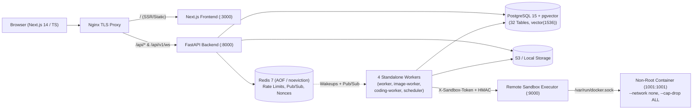
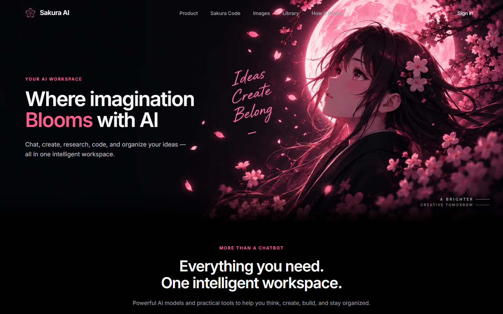
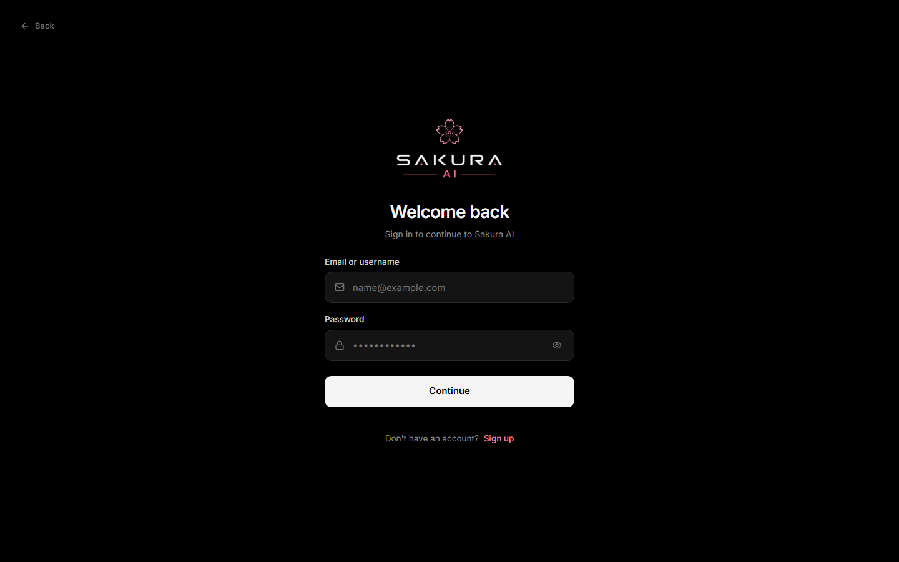
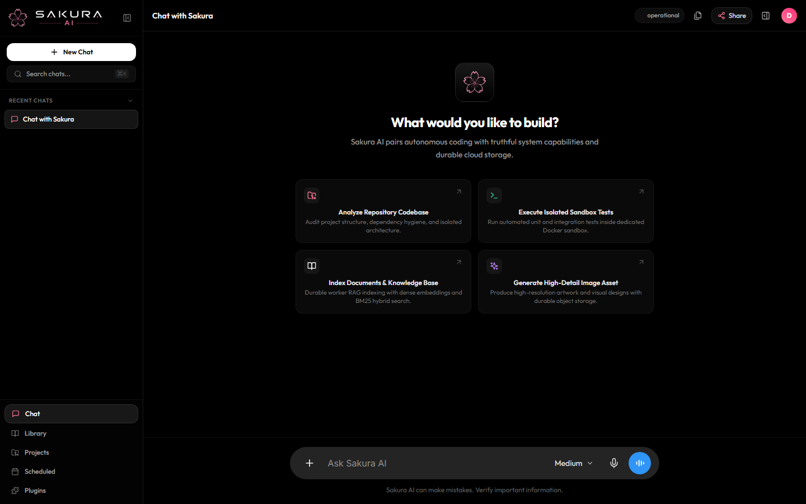
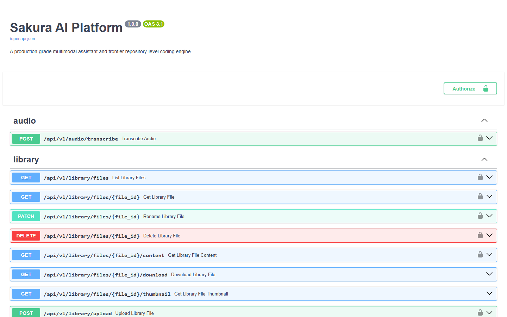

# SAKURA AI
## A Full-Stack Multi-Agent AI Workspace with Hybrid Semantic RAG, Durable Multi-Worker Orchestration, and Isolated Docker Code Execution

---

### Academic Major Project Report

| Field | Details |
| --- | --- |
| **Project Title** | Sakura AI — Full-Stack Multi-Agent AI Workspace & Coding Platform |
| **Student Name** | `[Student Name]` |
| **Registration / Roll No.** | `[University Roll Number]` |
| **Degree & Branch** | `[B.Tech / B.E. / M.Tech / MCA — Computer Science & Engineering]` |
| **Department & Institution** | `[Department Name, College / University Name]` |
| **Project Guide** | `[Guide Name, Designation]` |
| **Academic Year** | `[Academic Year, e.g., 2025–2026]` |
| **Source Repository** | `https://github.com/Abhiram-C-Divakaran/Sakura-AI` |

---

## Table of Contents

1. [Chapter 1 — Introduction](#chapter-1--introduction)
2. [Chapter 2 — Existing System and Proposed System](#chapter-2--existing-system-and-proposed-system)
3. [Chapter 3 — System Requirements](#chapter-3--system-requirements)
4. [Chapter 4 — System Architecture and Design](#chapter-4--system-architecture-and-design)
5. [Chapter 5 — Technology Stack](#chapter-5--technology-stack)
6. [Chapter 6 — Module Description](#chapter-6--module-description)
7. [Chapter 7 — Database Design](#chapter-7--database-design)
8. [Chapter 8 — Implementation](#chapter-8--implementation)
9. [Chapter 9 — Security](#chapter-9--security)
10. [Chapter 10 — Testing and Results](#chapter-10--testing-and-results)
11. [Chapter 11 — Limitations and Future Enhancements](#chapter-11--limitations-and-future-enhancements)
12. [Chapter 12 — Conclusion](#chapter-12--conclusion)

---

## Chapter 1 — Introduction

### 1.1 Project Introduction
**Sakura AI** is a full-stack, multi-tenant artificial intelligence platform designed to unify conversational reasoning, document intelligence via Hybrid Retrieval-Augmented Generation (RAG), persistent user memory, multimodal image generation, voice transcription, scheduled autonomous tasks, and repository-level code execution inside a single web workspace. Built with **FastAPI (Python 3.11+)**, **Next.js 14 (TypeScript / React 18)**, **PostgreSQL 15 + `pgvector`**, **Redis 7**, and an **isolated remote Docker sandbox**, the project demonstrates production-grade backend systems engineering alongside modern AI orchestration.

### 1.2 Background
Large Language Models (LLMs) have shifted software workflows from static CRUD applications toward interactive, agentic systems capable of reading documents, generating media, and modifying codebases. Yet turning an LLM API into a reliable multi-user software system requires solving classic distributed-systems and security problems: multi-tenant authorization, durable crash-safe job queues, hybrid semantic-plus-lexical retrieval, bounded resource consumption, and safe execution of untrusted code.

### 1.3 Problem Statement
Conventional academic and open-source AI assistant prototypes suffer from five recurring architectural shortcomings:
1. **Single-Provider Coupling & Privacy Risks:** Hardcoding one commercial LLM API leads to total downtime during upstream incidents and risks leaking sensitive prompts to external cloud APIs when local execution is intended.
2. **Incomplete Retrieval & Multi-Tenant Leakage:** Pure vector similarity misses exact identifiers (function names, error codes, legal clauses), while poorly scoped vector indices risk cross-user data leakage.
3. **Volatile In-Process Background Work:** Running document parsing, image generation, or storage cleanup in web-server memory causes silent job loss on restarts and race conditions under horizontal scaling.
4. **Unsafe Host-Level Code Execution:** Coding agents invoking shell commands directly on the API server expose environment secrets, databases, and sibling user workspaces.
5. **Weak Security Boundaries:** Passing JWTs in query strings (`?token=`), omitting daily quotas, failing open when Redis is unreachable, and lacking self-service account deletion undermine real-world deployability.

### 1.4 Motivation
The motivation behind Sakura AI is to bridge the gap between toy LLM demos and production-hardened software platforms by building a cohesive, verifiable reference implementation where every subsystem—from `pgvector(1536)` hybrid retrieval and lease-fenced workers to non-root Docker sandbox containers—is backed by automated regression and integration tests.

### 1.5 Project Objectives
1. Design a modular, multi-tenant full-stack AI platform with clean separation between presentation (`Next.js`), API (`FastAPI`), stateful persistence (`PostgreSQL 15 + pgvector`), coordination (`Redis 7`), background workers, and isolated execution (`sandbox-executor`).
2. Implement provider-neutral LLM routing across Groq, OpenAI, Anthropic, and local Ollama with transient-only failover and fail-closed privacy enforcement.
3. Build a per-user Hybrid RAG engine combining native PostgreSQL `pgvector(1536)` cosine distance with Okapi BM25 lexical scoring via Reciprocal Rank Fusion (RRF).
4. Engineer crash-safe, lease-fenced background workers (`worker`, `image-worker`, `coding-worker`, `scheduler`) and an asynchronous `StorageDeletionOutbox`.
5. Implement **Sakura Code**, an autonomous repository coding agent executing shell/test tools strictly inside ephemeral, non-root (`1001:1001`), network-disabled Docker containers with single-use HMAC capability gating.
6. Enforce end-to-end security controls (`PyJWT`, header-only file auth, single-use WS tickets, fail-closed Redis rate limits, daily quotas, account export/deletion) validated by automated CI.

### 1.6 Scope of the Project
Sakura AI covers authenticated user management, streaming multi-turn chat, conversation pinning/archiving/sharing, long-term memory, file/library management, document parsing and Hybrid RAG, asynchronous raster image generation/variations, audio transcription, project workspaces, GitHub integration, cron-scheduled tasks, and Docker-isolated repository coding.

### 1.7 Project Limitations
Sakura AI does not currently host a live public production deployment (external staging infrastructure with TLS/S3/SMTP must be provisioned separately), currently uses `next@14.2.35` (with `/_next/image` mitigated via `images.unoptimized: true` pending a dedicated Next.js 16 upgrade PR), implements prompt-context image edits rather than pixel-mask inpainting, and intentionally returns `HTTP 501` for non-GitHub third-party connectors. Full details appear in Chapter 11.

---

## Chapter 2 — Existing System and Proposed System

### 2.1 Existing Approaches to AI Assistant Platforms
Existing solutions generally fall into three categories:
1. **Closed Commercial Suites (e.g., ChatGPT, Claude.ai):** High model quality, but proprietary, closed-source, tied to a single vendor ecosystem, and non-customizable for institutional or self-hosted privacy boundaries.
2. **Lightweight Open-Source Chat Wrappers:** Provide simple chat UIs over API keys, but typically lack durable job queues, strict multi-tenant object-storage cleanup, hybrid BM25+vector retrieval, or isolated repository coding sandboxes.
3. **Standalone Coding Agents / CLI Tools:** Operate directly on a developer's local workstation with full host filesystem and network privileges, making them unsuitable for multi-user hosted web environments.

### 2.2 Limitations of Conventional Solutions
- Tight coupling to one LLM provider without transient-error classification or privacy boundaries.
- Vector-only retrieval that degrades on code symbols, IDs, and domain acronyms.
- Loss of in-flight jobs on server restart due to in-memory task runners (`BackgroundTasks` without DB durability).
- Direct host subprocess execution exposing host credentials and sibling files.
- Absence of auditable data lifecycle controls (data export, cascading account deletion, outbox storage purge).

### 2.3 Proposed Sakura AI System
Sakura AI unifies conversational AI, Hybrid RAG, multimodal generation, scheduled automation, and isolated coding inside one coherent, database-authoritative architecture:
- **PostgreSQL 15 + `pgvector`** acts as the single source of truth for relational records, `vector(1536)` embeddings, job queues, worker leases, quotas, and storage deletion outbox entries.
- **Four decoupled worker services** (`worker`, `image-worker`, `coding-worker`, `scheduler`) process asynchronous workloads independently of HTTP request lifecycles using `FOR UPDATE SKIP LOCKED` and conditional lease fencing.
- **Remote `sandbox-executor`** isolates `/var/run/docker.sock` away from the web API and coding worker, executing untrusted commands inside non-root (`1001:1001`) ephemeral containers with `--network none` by default.

### 2.4 Advantages of the Proposed Approach
- **Zero vendor lock-in** with automatic transient failover and hard local-only privacy enforcement.
- **Superior retrieval accuracy** via Hybrid `pgvector` + Okapi BM25 + RRF while honestly falling back to BM25 when embedding keys are unconfigured.
- **Crash-resilient multi-worker scaling** immune to split-brain terminal overwrites.
- **Verifiable security posture** continuously audited via 253 local tests and 4 required GitHub Actions CI workflows.

### 2.5 Comparative Analysis

| Feature / Dimension | Conventional Chat Wrapper | Local CLI Coding Agent | Proposed Sakura AI Platform |
| --- | --- | --- | --- |
| **LLM Routing** | Single hardcoded vendor | Single vendor / local | Multi-provider (`Groq`, `OpenAI`, `Anthropic`, `Ollama`) + fail-closed private mode |
| **RAG Retrieval** | Dense vector only or none | Local grep only | Hybrid PostgreSQL `pgvector(1536)` + Okapi BM25 + RRF, per-user scoped |
| **Async Job Durability** | Volatile in-memory threads | Foreground terminal | PostgreSQL authoritative queues + lease fencing + crash recovery |
| **Code Execution Safety** | None or host `subprocess` | Full host OS privileges | Dedicated remote `sandbox-executor`, non-root `1001:1001`, `--network none`, HMAC capabilities |
| **Storage Deletion** | Best-effort sync unlink | Manual | `HTTP 202` + `StorageDeletionOutbox` + killable subprocess runner |
| **Multi-Tenant Auth & Quotas** | Basic JWT / often `?token=` | Single local user | `PyJWT` header-only auth, single-use WS tickets, Redis rate limits, atomic daily quotas |

---

## Chapter 3 — System Requirements

Complete tabular requirements are also maintained in [`REQUIREMENTS_SPECIFICATION.md`](REQUIREMENTS_SPECIFICATION.md).

### 3.1 Functional Requirements Summary
- **Identity & Governance (FR-01, FR-11):** Registration with password strength validation, `PyJWT` (`HS256`) login, SMTP password reset, atomic daily per-user quotas (`chat: 500`, `image_generation: 50`, `coding_task: 50`, `file_upload: 100`, `scheduled_job: 30`), async ZIP data export, and audited account deletion (`DELETE /api/v1/auth/me`).
- **Conversational AI & Memory (FR-02, FR-03):** Streaming SSE chat, conversation CRUD/pin/archive/search/share, message feedback, long-term memory extraction, and intent-based multi-provider routing with local-private enforcement.
- **Document Intelligence & Hybrid RAG (FR-04, FR-05):** Multi-format file upload (`PDF`, `MD`, `TXT`, code, images), header-only authenticated downloads, asynchronous `StorageDeletionOutbox` purge, `pdfplumber`/text chunking, `text-embedding-3-small` embeddings, and `pgvector` + BM25 RRF search.
- **Multimodal & Automation (FR-06, FR-07, FR-08, FR-09):** Asynchronous raster image generation & idempotent variations (`HTTP 400`/`202`/`409`), Whisper audio transcription (25 MB cap), project grouping, verified GitHub integration, and timezone-aware cron scheduled tasks.
- **Sakura Coding Engine (FR-10):** Isolated repository workspaces, durable coding jobs, live SSE event streaming with `after_sequence` replay, cooperative cancellation, and single-use HMAC-authorized network commands.

### 3.2 Non-Functional Requirements
- **Security:** Strict tenant scoping (`404` on cross-user access), zero URL tokens (`401` on `?token=`), fail-closed startup guards in production, and non-root container isolation (`--cap-drop ALL`, `no-new-privileges:true`).
- **Reliability & Concurrency:** Zero lost jobs on crash, lease-fenced terminal writes, unique scheduled occurrence deduplication, and `0` orphaned sandbox containers verified in CI.
- **Observability:** `X-Request-ID` correlation across requests, `/health` liveness probe, truthful `/readiness` probe (verifying DB, Alembic revision `j9f7a263b56c`, Redis, storage, and secrets), and `/api/v1/capabilities`.
- **Portability:** Seamless local SQLite development paired with strict PostgreSQL 15 + Redis 7 + Docker production parity.

### 3.3 Hardware, Software & External Service Requirements
- **Development Hardware:** 4-core 64-bit CPU, 8–16 GB RAM, 10 GB disk.
- **Staging/Production Hardware:** 4+ vCPUs, 8–16 GB RAM, 40+ GB SSD, dedicated `sandbox-executor` host isolating `/var/run/docker.sock`.
- **Software:** Python 3.11+, Node.js 20/22 LTS, PostgreSQL 15 (`pgvector/pgvector:pg15`), Redis 7 (`redis:7-alpine`), Docker Engine + Compose v2, Nginx 1.24+.
- **External Services:** At least one LLM key (`GROQ_API_KEY`, `OPENAI_API_KEY`, `ANTHROPIC_API_KEY`, or `OLLAMA_BASE_URL`); optional `OPENAI_API_KEY` (embeddings & Whisper), `TAVILY_API_KEY`, Pollinations raster endpoint, S3-compatible storage, and SMTP relay.

---

## Chapter 4 — System Architecture and Design

All 9 detailed Mermaid diagrams are maintained as standalone architecture blueprints in [`docs/architecture/`](../architecture/):
- **Diagram 1 (Overall System Architecture):** [`SYSTEM_ARCHITECTURE.md`](../architecture/SYSTEM_ARCHITECTURE.md)
- **Diagrams 2, 3 & 7 (API Communication, Auth Lifecycle, Durable Workers & Outbox):** [`API_WORKFLOW.md`](../architecture/API_WORKFLOW.md)
- **Diagrams 4 & 5 (AI Conversation Routing & Hybrid RAG Pipeline):** [`AI_RAG_WORKFLOW.md`](../architecture/AI_RAG_WORKFLOW.md)
- **Diagram 6 (Complete 32-Table Database ER Diagram):** [`DATABASE_ER_DIAGRAM.md`](../architecture/DATABASE_ER_DIAGRAM.md)
- **Diagrams 8 & 9 (Sakura Coding Engine & Docker Sandbox Isolation):** [`CODING_SANDBOX_WORKFLOW.md`](../architecture/CODING_SANDBOX_WORKFLOW.md)

### 4.1 High-Level Architectural Overview



*Figure 4.1: High-level 10-service Sakura AI production topology (`anime-ai/docker-compose.prod.yml`).*

### 4.2 Architectural Subsystems
- **Frontend Architecture (`anime-ai/frontend/`):** Next.js 14 Pages Router with React 18, TypeScript, Tailwind CSS, and Framer Motion. Centralized `authFetch` (`lib/api.ts`) injects `Authorization: Bearer` headers and handles Blob downloads (`AuthenticatedImage`, `FilePreviewModal`) without putting JWTs in URLs. Dedicated hooks (`useRealtime`, `useTasks`, `useCodingTaskStream`) manage ticket-authenticated WebSockets and SSE event streams. `next.config.js` disables `/_next/image` (`images: { unoptimized: true }`) and removes `X-Powered-By`.
- **Backend Architecture (`anime-ai/backend/`):** Modular FastAPI application (`main.py`) with 8 focused API routers (`routes`, `library`, `coding`, `scheduled`, `projects`, `integrations`, `audio`, `capabilities`), HTTP correlation/latency middleware (`X-Request-ID`), and strict lifespan startup guards (`settings.validate_production_guards()`).
- **Database, Auth, AI, Worker & Sandbox Architectures:** Detailed individually in Chapters 6, 7, 8, and 9 and visualized in full in `docs/architecture/`.

---

## Chapter 5 — Technology Stack

| Technology | Layer | Exact Responsibility in Sakura AI | Why Chosen |
| --- | --- | --- | --- |
| **Python 3.11+** | Backend & Workers | Implements FastAPI API, async workers, RAG pipeline, and sandbox service | First-class AI/ML SDK ecosystem (`openai`, `anthropic`, `pdfplumber`, `pgvector`) and `asyncio` concurrency |
| **FastAPI & Uvicorn** | Web / API Framework | REST endpoints, OpenAPI docs (`/docs`), SSE streaming, WebSocket hub | Native async I/O, Pydantic v2 request validation, dependency injection for auth/DB sessions |
| **Next.js 14 (React 18, TypeScript 5)** | Frontend | Marketing pages, authenticated `/chat` & `/console` workspaces, API rewrites | Hybrid static/SSR rendering, strong TypeScript safety, clean component modularity |
| **Tailwind CSS & Framer Motion** | Styling / UI | Responsive dark/light theme system (`ThemeContext`) and fluid UI transitions | Utility-first consistency without runtime CSS-in-JS bloat |
| **PostgreSQL 15** | Primary Database | Authoritative persistence for 32 tables, ACID transactions, `FOR UPDATE SKIP LOCKED` | Strong relational integrity, concurrent job locking, mature backup/restore (`pg_dump`/`pg_restore`) |
| **`pgvector` (`vector(1536)`)** | Vector Store | Stores 1536-d document embeddings and runs cosine distance (`<=>`) queries | Eliminates separate vector DB sync bugs; keeps tenant FK constraints and vectors inside one ACID transaction |
| **SQLAlchemy 2 & Alembic** | ORM & Migrations | Dialect-aware ORM (`Vector(1536)` on PG, `JSON` on SQLite) + 11 schema migrations | Prevents schema drift; enables automated schema parity verification in CI |
| **Redis 7 (AOF, `noeviction`)** | Coordination | Sliding-window rate limits, worker wakeups, multi-worker WS Pub/Sub, single-use capability nonces | Atomic sub-millisecond counters (`INCR`/`EXPIRE`), cross-process Pub/Sub, durable nonce enforcement |
| **PyJWT & Passlib (`pbkdf2_sha256`)** | Auth Security | `HS256` JWT signing/verification (`auth/manager.py`) and salted password hashing | Actively maintained cryptography replacing unmaintained `python-jose` |
| **Boto3 / Local FS** | Object Storage | Pluggable `StorageBackend` (`services/storage.py`) for documents, images, and ZIP exports | Seamless local filesystem development and S3/R2 cloud scalability |
| **Groq, OpenAI, Anthropic, Ollama** | LLM & Embeddings | Multi-provider chat routing, OpenAI `text-embedding-3-small`, OpenAI Whisper STT | Resilience against single-vendor outages plus air-gapped local privacy via Ollama |
| **Pollinations / Tavily / DuckDuckGo** | Media & Search | Raster image generation pipeline (`media/image_engine.py`) and optional live web search | Multimodal capabilities with honest capability flags and bounded timeouts |
| **Docker & Docker Compose** | Isolation & Ops | 10-service production stack and ephemeral non-root coding sandbox containers | Reproducible deployment and kernel-level namespace/cgroup isolation for untrusted code |
| **Nginx** | Reverse Proxy | TLS 1.2/1.3 termination, security headers, unbuffered SSE, WebSocket upgrade | Hardens public ingress and manages connection buffering cleanly |
| **Playwright & `unittest`** | Testing & CI | 253+ backend unit/concurrency tests and unmocked full-stack browser E2E in GitHub Actions | Prevents security regressions and proves end-to-end production topology integrity |

---

## Chapter 6 — Module Description

Sakura AI comprises **14 implemented functional modules**. Full 7-point specifications (Purpose, Internal Workflow, Backend Components, Frontend Components, Database Interactions, External Dependencies, and Status) are documented in [`MODULE_DOCUMENTATION.md`](MODULE_DOCUMENTATION.md). Summary matrix:

| # | Module | Primary Backend Files | Primary Frontend Files | Key Tables | Verified Status |
| --- | --- | --- | --- | --- | --- |
| 1 | User Auth & Account Lifecycle | `auth/manager.py`, `services/account.py`, `services/email.py` | `pages/login.tsx`, `AccountMenu.tsx` | `users`, `password_reset_tokens`, `user_data_exports`, `account_audit_events` | **Verified** |
| 2 | AI Conversation & Router | `llm/router.py`, `llm/agent.py`, `llm/providers/*` | `pages/chat.tsx`, `ConversationView.tsx`, `ChatComposer.tsx` | `conversations`, `messages`, `characters` | **Verified** |
| 3 | Persistence, Sharing & Memory | `api/routes.py`, `memory/manager.py` | `Sidebar.tsx`, `SearchModal.tsx`, `pages/share/[token].tsx` | `conversation_shares`, `message_feedbacks`, `user_memories` | **Verified** |
| 4 | Document & Library Storage | `api/library.py`, `services/storage.py`, `services/storage_delete_runner.py` | `LibraryView.tsx`, `FilePreviewModal.tsx`, `AuthenticatedImage.tsx` | `documents`, `storage_deletion_outbox` | **Verified** |
| 5 | Document Parsing & Intelligence | `rag/ingestion/parser.py`, `services/documents.py` | `LibraryView.tsx`, `AttachmentChips.tsx` | `documents`, `document_chunks` | **Verified** |
| 6 | Hybrid RAG & Vector Search | `rag/embeddings/manager.py`, `rag/retrieval.py` | `ContextPanel.tsx`, `ConversationFilesSheet.tsx` | `document_chunks` (`vector(1536)`) | **Verified (CI PG15)** |
| 7 | Image & Media Generation | `media/image_engine.py`, `media/image_worker.py` | `GenerateImageModal.tsx`, `ImageLightboxModal.tsx` | `image_generation_jobs`, `image_variation_batches`, `generated_images` | **Verified** |
| 8 | Voice & Audio Transcription | `api/audio.py` | `VoiceRecorder.tsx` | `users` | **Implemented (Needs `OPENAI_API_KEY`)** |
| 9 | Durable Tasks & Scheduler | `tasks/worker.py`, `tasks/scheduler.py`, `api/scheduled.py` | `ScheduledView.tsx`, `hooks/useTasks.ts` | `background_tasks`, `scheduled_tasks`, `scheduled_task_runs` | **Verified (CI PG15)** |
| 10 | Sakura Coding Engine | `api/coding.py`, `coding/{agent,job_worker,tools,patching}.py` | `pages/console.tsx`, `components/coding/*` | `repository_workspaces`, `coding_jobs`, `coding_tasks`, `coding_task_events`, `tool_executions` | **Verified (CI E2E)** |
| 11 | Docker Sandbox Isolation | `coding/{sandbox,sandbox_service,capabilities}.py`, `sandbox/Dockerfile` | `components/coding/ToolExecution.tsx` | `sandbox_network_authorizations` | **Verified (CI E2E)** |
| 12 | Projects & Integrations | `api/projects.py`, `api/integrations.py`, `auth/crypto.py` | `ProjectsView.tsx`, `PluginsView.tsx`, `ConnectAppsModal.tsx` | `projects`, `project_*`, `user_integrations` | **Implemented (GitHub Live; Others 501)** |
| 13 | Quotas & Rate Limiting | `services/quotas.py`, `services/rate_limit.py` | `AccountMenu.tsx`, `lib/api.ts` | `user_usage_quotas` | **Verified** |
| 14 | Real-Time WS & Readiness | `realtime/manager.py`, `api/capabilities.py`, `main.py` | `hooks/useRealtime.ts`, `TopBar.tsx` | `websocket_tickets` | **Verified** |

---

## Chapter 7 — Database Design

### 7.1 Database Architecture
Sakura AI uses **PostgreSQL 15 with the `pgvector` extension** in staging, CI, and production, and supports **SQLite** transparently for zero-friction local development via a dialect-aware `Vector(1536)` column definition in `anime-ai/backend/database/models.py`:
- On **PostgreSQL**, `document_chunks.embedding` uses native `vector(1536)` backed by `CREATE EXTENSION IF NOT EXISTS vector`.
- On **SQLite**, the exact same ORM model seamlessly falls back to `JSON()` via `.with_variant(JSON(), "sqlite")`.

### 7.2 Actual Tables Inventory (32 Tables)
The complete Entity-Relationship diagram and 11-revision Alembic chain (`8936a43c2fb5` through `j9f7a263b56c`) are provided in [`docs/architecture/DATABASE_ER_DIAGRAM.md`](../architecture/DATABASE_ER_DIAGRAM.md). Tables group logically into six domains:

1. **Identity, Auth & Governance (6):** `users`, `password_reset_tokens`, `websocket_tickets`, `user_usage_quotas`, `user_data_exports`, `account_audit_events`.
2. **Conversations & Memory (6):** `characters`, `conversations`, `messages`, `message_feedbacks`, `conversation_shares`, `user_memories`.
3. **Documents, RAG & Outbox (3):** `documents`, `document_chunks` (`embedding vector(1536)`), `storage_deletion_outbox`.
4. **Projects & Integrations (5):** `projects`, `project_conversations`, `project_files`, `project_repositories`, `user_integrations`.
5. **Multimodal Media (3):** `generated_images` (with self-referential `parent_image_id` lineage), `image_generation_jobs`, `image_variation_batches` (with `idempotency_key` + `request_fingerprint`).
6. **Durable Workers, Scheduling & Coding Engine (9):** `background_tasks`, `scheduled_tasks`, `scheduled_task_runs`, `repository_workspaces`, `coding_jobs`, `coding_tasks`, `coding_task_events`, `tool_executions`, `sandbox_network_authorizations`.

### 7.3 Key Integrity Constraints & Migration Strategy
- **Cascading Ownership:** Almost every tenant entity holds `user_id UUID REFERENCES users(id) ON DELETE CASCADE` (except `account_audit_events`, which retains `subject_user_id` without a cascading FK so deletion audit entries survive user removal).
- **Idempotency & Deduplication:** Unique constraints enforce `(task_id, scheduled_for)` on `scheduled_task_runs` and `(user_id, idempotency_key)` on `image_generation_jobs` and `image_variation_batches`.
- **Lease Fencing Columns:** `background_tasks`, `coding_jobs`, `image_generation_jobs`, and `storage_deletion_outbox` all store `worker_id`, `execution_attempt_id` (or `claim_token`), and `lease_expires_at` for split-brain prevention.
- **Schema Governance:** In production (`ENVIRONMENT=production`), `main.py` disables `Base.metadata.create_all()`; schema changes occur exclusively via Alembic migrations verified by `test_schema_parity.py` and checked at runtime by `/readiness` (`schema_revision == j9f7a263b56c`).

---

## Chapter 8 — Implementation

### 8.1 API Request Lifecycle (`anime-ai/backend/main.py`)
Every HTTP request enters `add_correlation_and_latency` middleware, which assigns or propagates `X-Request-ID`, records request latency into a bounded 50-sample ring buffer (`LATENCY_SAMPLES`), delegates to route-level rate limiters (`services/rate_limit.py`) and `AuthManager.get_current_user` (`auth/manager.py`), validates UUID path parameters (`HTTP 400` on malformed UUIDs), enforces `user_id` ownership (`HTTP 404` on cross-tenant access), and returns structured JSON or streaming SSE responses.

### 8.2 Authentication & Authorization (`auth/manager.py`, `auth/authorization.py`)
`AuthManager` signs JWTs using `PyJWT` (`HS256`) with `JWT_SECRET` (production startup refuses default or `< 32`-character secrets). Passwords use Passlib `pbkdf2_sha256`. File downloads (`api/library.py`) strictly parse `Authorization: Bearer` headers and reject `?token=` query parameters with `HTTP 401`. WebSockets (`realtime/manager.py`) exchange Bearer tokens for single-use 60-second tickets (`POST /api/v1/auth/ws-ticket`) atomically marked `consumed_at` upon upgrade.

### 8.3 AI Provider Communication (`llm/router.py`, `llm/providers/*`)
`LLMRouter` initializes configured adapters (`GroqProvider`, `OpenAIProvider`, `AnthropicProvider`, `OllamaProvider`) with bounded HTTP timeouts (`EMBEDDING_TIMEOUT_SECONDS=30.0`, provider stream timeouts). `is_transient_error()` separates retryable transient outages (`429`, `502`/`503`/`504`, timeout, connection reset) from non-retryable auth errors (`401`, `403`). For intents in `PRIVATE_INTENTS = {"local_private", "private_data"}`, `get_ordered_providers()` permits **only** `["ollama"]`, raising `PrivateModelUnavailableError` if unconfigured.

### 8.4 Document Ingestion & Hybrid RAG (`rag/ingestion/parser.py`, `rag/retrieval.py`)
Uploads store raw bytes in `StorageBackend` under `users/<user_id>/...`, create a `documents` row (`index_generation` incremented), and enqueue an indexing task. The worker parses text (`pdfplumber` for PDFs), splits overlapping 800-character chunks (150-character overlap), requests 1536-d embeddings via `EmbeddingManager` (storing `NULL` cleanly when `OPENAI_API_KEY` is unset), and commits chunks only if `index_generation` and `deletion_status='ACTIVE'` remain unchanged. At query time, `rag/retrieval.py` combines PostgreSQL `pgvector` cosine distance (`<=>`) and Okapi BM25 (`k1=1.5`, `b=0.75`) via Reciprocal Rank Fusion (`RRF`), strictly joined on `Document.user_id == current_user.id`.

### 8.5 Durable Background Jobs & Outbox (`tasks/worker.py`, `services/storage_delete_runner.py`)
Workers claim eligible rows using PostgreSQL `FOR UPDATE SKIP LOCKED` (or CAS `UPDATE` on SQLite), stamping a unique `execution_attempt_id` / `claim_token` and `lease_expires_at`. Periodic heartbeats renew leases only when the token still matches. Before committing a terminal status (`COMPLETED`/`FAILED`), every worker executes a conditional update requiring `execution_attempt_id == mine AND lease_expires_at > NOW()`—preventing a paused or network-partitioned worker from overwriting work reclaimed by another worker. Storage deletions execute inside a bounded, killable child process (`storage_delete_runner.py`) so hung S3/OS calls cannot wedge a worker indefinitely.

### 8.6 Coding-Agent Execution & Sandbox Isolation (`coding/job_worker.py`, `coding/sandbox_service.py`)
`coding/job_worker.py` claims `coding_jobs` and drives `coding/agent.py` across a tool loop (`CodingToolchain`), recording sequential `coding_task_events` for live SSE replay (`after_sequence`). Shell and test commands are forwarded over HTTP (`X-Sandbox-Token`) to `coding/sandbox_service.py` (`:9000`), which validates workspace UUID containment, enforces an allowlisted child environment, and executes:
```text
docker run --rm --name sakura-exec-<id> \
  --user 1001:1001 --network none \
  --cpus=2.0 --memory=512m --pids-limit=64 \
  --security-opt no-new-privileges:true --cap-drop ALL \
  -v <workspace_root>:/workspace:rw -w /workspace sakura-sandbox <cmd>
```
Networked commands (`--network bridge`) are denied unless accompanied by a valid HMAC-SHA256 capability token bound to workspace ID, exact command hash, and expiry, consumed atomically once in Redis.

### 8.7 Live Application Screenshots (Captured from Running Local Stack)
Actual screenshots captured via Playwright Chromium against the live Next.js (`http://127.0.0.1:3000`) and FastAPI (`http://127.0.0.1:8000`) servers:


*Figure 8.1: Sakura AI landing page (`http://127.0.0.1:3000/`) showcasing platform capabilities and navigation.*


*Figure 8.2: Authenticated login & registration interface (`http://127.0.0.1:3000/login`).*


*Figure 8.3: Authenticated Sakura AI workspace (`http://127.0.0.1:3000/chat`) displaying persistent sidebar conversations, multimodal composer, and context controls.*


*Figure 8.4: Auto-generated FastAPI OpenAPI / Swagger interface (`http://127.0.0.1:8000/docs`) documenting all REST routes.*

---

## Chapter 9 — Security

### 9.1 Implemented Security Controls (Verified in Code & Tests)

| Security Domain | Implemented Controls | Verification Source |
| --- | --- | --- |
| **Authentication** | `PyJWT` (`HS256`), Passlib `pbkdf2_sha256`, password strength validation (>= 8 chars), single-use hashed password reset tokens, single-use 60s WebSocket tickets | `auth/manager.py`, `test_auth_security.py`, `test_ws_ticket.py` |
| **Authorization & Tenant Isolation** | Strict `user_id` ownership verification across conversations, messages, documents, chunks, images, projects, tasks, and workspaces (`404` on cross-tenant access); `users/<user_id>/...` storage prefixing | `auth/authorization.py`, `test_workspace_topology_e2e.py`, live 37/37 check |
| **Input Validation** | Pydantic v2 schemas, strict UUID validation (`400`), `ALLOWED_USER_TASK_TYPES` allowlist blocking forged internal tasks (`400`), 25 MB audio cap & extension allowlist, path/symlink traversal checks (`WorkspaceSecurity`) | `api/routes.py`, `api/audio.py`, `coding/security.py` |
| **Secret Management** | Production startup guards (`settings.validate_production_guards()`) refuse missing, default, short (`< 32` chars), or reused secrets across `JWT_SECRET`, `INTEGRATION_ENCRYPTION_KEY`, `SAKURA_SANDBOX_SERVICE_TOKEN`, and `SAKURA_SANDBOX_CAPABILITY_SIGNING_KEY`; Fernet encryption for stored integration tokens; zero backend secrets passed to sandbox child env | `config/settings.py`, `auth/crypto.py`, `ops/scripts/validate_env.py` |
| **Rate Limiting & Quotas** | Redis sliding-window rate limits with `TRUSTED_PROXY_CIDRS`-validated `X-Forwarded-For` parsing (fail-closed `503` if Redis is unavailable in prod); atomic UTC-day `user_usage_quotas` | `services/rate_limit.py`, `services/quotas.py`, `test_fail_closed_security_regression.py` |
| **File & Frontend Hardening** | Header-only `Authorization: Bearer` file downloads (`?token=` rejected `401`), `poweredByHeader: false`, `images: { unoptimized: true }` disabling `/_next/image` (`404`), strict non-wildcard CORS in production | `api/library.py`, `frontend/next.config.js` |
| **Docker Sandbox Security** | Separate `sandbox-executor` host boundary, `X-Sandbox-Token`, non-root `UID 1001:1001`, `--network none` default, `--cap-drop ALL`, `no-new-privileges:true`, CPU/RAM/PID caps (`2.0`/`512m`/`64`), single-workspace bind mount, Redis-backed single-use HMAC capability tokens, kill-before-remove cleanup | `coding/sandbox_service.py`, `coding/capabilities.py`, CI Docker Sandbox E2E |

### 9.2 Recommended Security Improvements (Pre-Public Launch)
1. **Upgrade Next.js `14.2.35` -> `16.x` (React 19):** Resolves upstream `npm audit` advisories (`next`, `postcss`, `source-map-js`) beyond the current `/_next/image` mitigation.
2. **Automated Dependency Scanning in CI:** Add `pip-audit` and `npm audit --audit-level=high` jobs to `.github/workflows/ci.yml`.
3. **MicroVM / Rootless Isolation for Public Multi-Tenant SaaS:** Pair `sandbox-executor` with a dedicated VM/host, gVisor (`runsc`), or Firecracker microVMs before opening coding execution to anonymous public internet signups.
4. **Object-Age Grace Window on Orphan Storage Sweeps:** Prevent any theoretical race between slow multipart uploads and scheduled orphan-storage cleanup jobs.

---

## Chapter 10 — Testing and Results

The full 13-row verification table covering all 8 testing layers is maintained in [`TESTING_DOCUMENTATION.md`](TESTING_DOCUMENTATION.md). Key verified highlights:

- **Local Backend Compilation & Test Suite (`d8de865`):** `python -m compileall` passed (`0` errors); `unittest discover` ran **271 tests -> 253 PASSED, 18 environment-gated skipped (PG/Docker flags), 0 failures**.
- **Local Frontend Build & Lint (`d8de865`):** `tsc --noEmit` (`0` errors), `next lint` (`0` errors, 10 pre-existing non-blocking warnings), `next build` (`12/12` static pages compiled).
- **Live Local Full-Stack User Journeys:** **37/37 checks PASSED (`0` failed)** against live `:3000` + `:8000` servers (auth, PyJWT, `/_next/image` `404`, quotas, conversations, library Bearer vs `?token=` `401`, cross-tenant `404`, malformed UUID `400`, WS ticket, forged internal task `400`, coding workspace isolation, and `DELETE /api/v1/auth/me`).
- **GitHub Actions CI (Run `46167864598` on `03e213d`):** **4/4 required Linux CI jobs PASSED (`conclusion: success`)**:
  1. `Backend Tests & Schema Verification` (Real PostgreSQL 15 + `pgvector`, Redis 7, Alembic upgrade, 32-table parity, concurrency & `pgvector` tests with `0` skips, official `postgres:15` backup/restore positive + tampered `.sha256` negative tests).
  2. `Frontend Typecheck & Build` (`tsc`, `next lint`, `next build`, Playwright landing smoke tests, production frontend Docker image).
  3. `Docker Sandbox E2E Integration` (Real non-root Docker execution, capability enforcement, `0` orphaned containers).
  4. `Full-Stack Integration Tests` (PG15 + Redis + Remote Docker Executor + API + 3 Separate Workers + Next.js + unmocked Playwright browser E2E, `0` orphaned containers).

---

## Chapter 11 — Limitations and Future Enhancements

Detailed engineering limitations and roadmap priorities are documented in [`LIMITATIONS_AND_FUTURE_SCOPE.md`](LIMITATIONS_AND_FUTURE_SCOPE.md). In brief:
- **Key Current Limitations:** No externally provisioned live staging host yet; pending Next.js 14 -> 16 upgrade; prompt-context image edits rather than pixel-mask inpainting; non-GitHub third-party connectors returning honest `HTTP 501`; optional `OPENAI_API_KEY` requirement for dense embeddings and Whisper STT (with honest BM25 fallback); draft `/privacy` and `/terms` pages.
- **Priority Future Work:** Provision controlled private staging with live TLS/S3/SMTP and backup/restore drill; complete Next.js 16 + React 19 upgrade and CI dependency auditing; add local open-source embedding models and `pgvector` HNSW indexes; integrate Prometheus/OpenTelemetry observability; evaluate gVisor/Firecracker for public multi-tenant sandboxing.

---

## Chapter 12 — Conclusion

Sakura AI demonstrates that an academic final-year software engineering project can move well beyond a single-endpoint LLM prototype to implement genuine production systems architecture. Across **32 normalized database tables**, **11 Alembic migrations**, **4 standalone lease-fenced worker processes**, a **Hybrid `pgvector(1536)` + Okapi BM25 RAG engine**, and an **isolated remote Docker coding sandbox**, the platform addresses the hardest real-world challenges of multi-tenant AI software: privacy, data isolation, crash recovery, idempotency, and safe untrusted code execution.

Backed by **253 passing local backend tests**, **live verified user journeys**, and **4/4 green GitHub Actions CI workflows** (Run `46167864598`), Sakura AI stands ready for formal college project evaluation, technical viva defense, software engineering interviews, and controlled private staging deployment.
