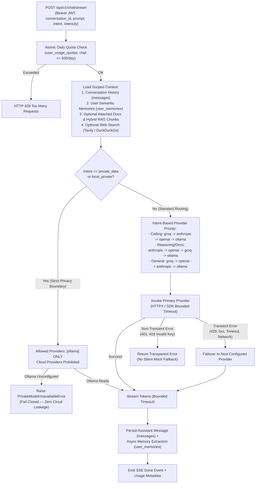
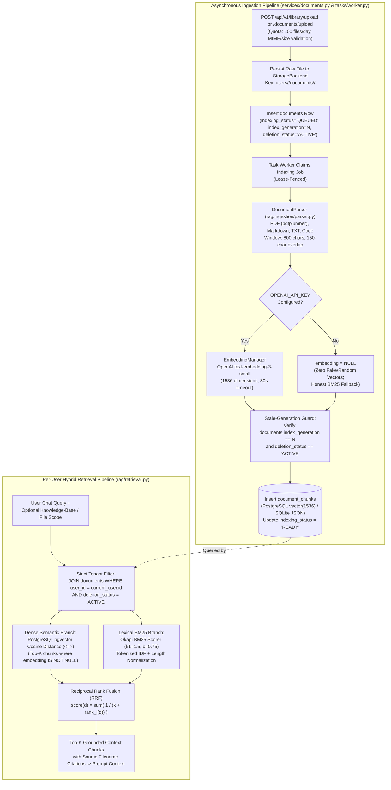

# Sakura AI — AI Conversation & Hybrid RAG Workflows

This document details the multi-provider conversational routing pipeline (`llm/router.py`, `llm/agent.py`) and the per-user Hybrid Retrieval-Augmented Generation pipeline (`rag/ingestion/parser.py`, `rag/embeddings/manager.py`, `rag/retrieval.py`).

---

## Diagram 4: AI Conversation & Multi-Provider Failover Workflow

*Figure 4: Conversational AI execution pipeline (`llm/router.py`, `llm/agent.py`) illustrating quota enforcement, context assembly, fail-closed private routing, and transient-only provider failover.*

---

## Diagram 5: Document Ingestion & Hybrid RAG (`pgvector` + Okapi BM25) Workflow

*Figure 5: End-to-end Document Intelligence and Hybrid RAG pipeline showing generation-fenced indexing, honest `NULL` embedding fallback when unconfigured, native `pgvector(1536)` cosine retrieval, Okapi BM25 lexical scoring, and Reciprocal Rank Fusion.*
