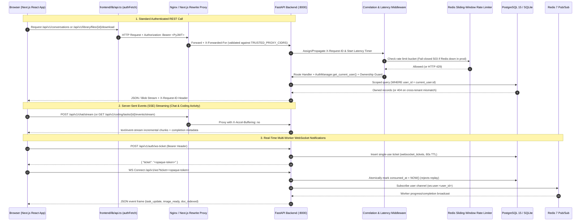
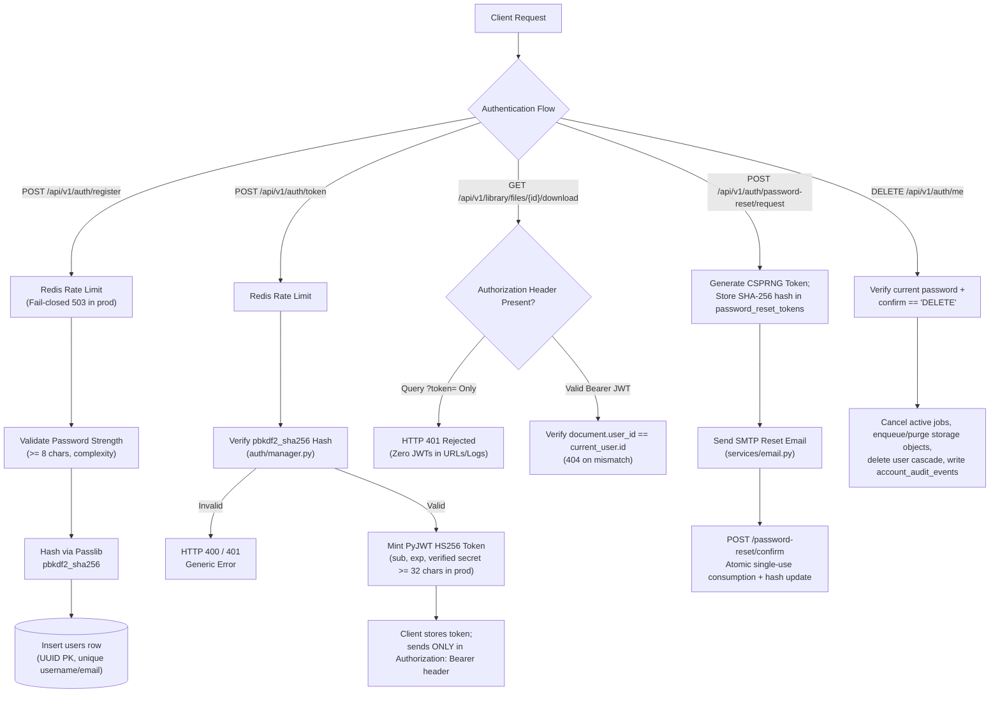
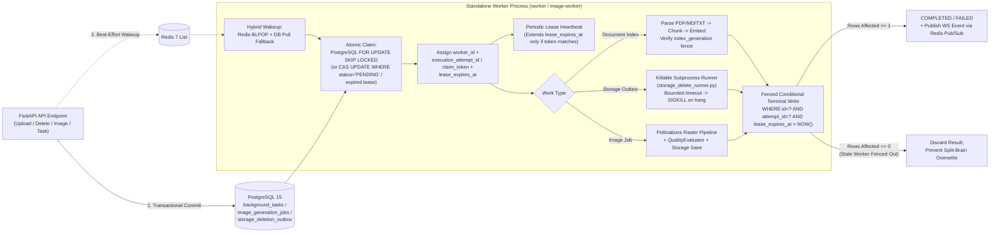

# Sakura AI — API Communication, Authentication & Background Job Workflows

This document covers frontend-backend communication, authentication and WebSocket session security, and the database-authoritative durable worker + outbox lease-fencing architecture.

---

## Diagram 2: Frontend and Backend Communication

*Figure 2: Frontend-to-backend communication patterns across REST (`authFetch` with header-only Bearer auth), unbuffered SSE streaming, and ticket-authenticated multi-worker WebSockets.*

---

## Diagram 3: Authentication, Password Reset & Account Lifecycle Workflow

*Figure 3: Authentication architecture (`anime-ai/backend/auth/manager.py`, `auth/authorization.py`, `services/account.py`) illustrating `PyJWT` `HS256` signing, header-only file authentication, single-use password reset tokens, and self-service account deletion.*

---

## Diagram 7: Durable Background Job & Storage Deletion Outbox Processing

*Figure 7: Database-authoritative durable worker and outbox lease-fencing architecture preventing duplicate execution, split-brain terminal writes after lease expiry, and hung S3/storage deletion calls.*
