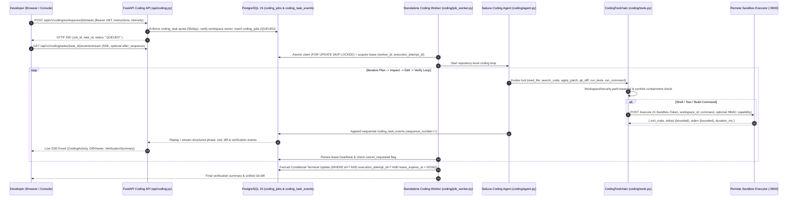
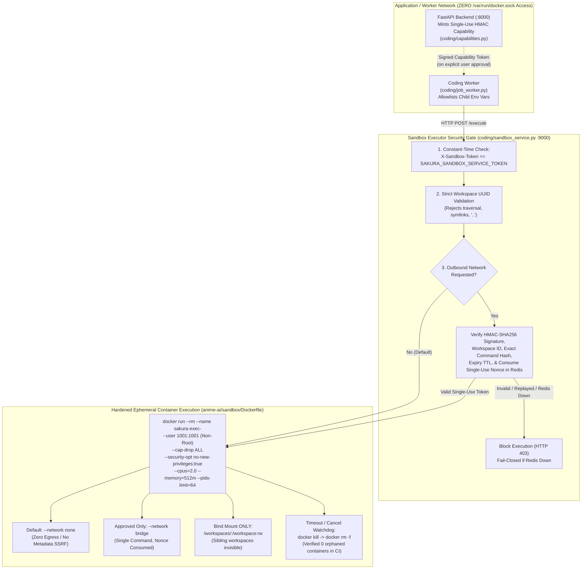

# Sakura AI — Sakura Coding Engine & Docker Sandbox Isolation

This document details the durable execution lifecycle of **Sakura Code** (`coding/agent.py`, `coding/job_worker.py`, `coding/tools.py`) and the defense-in-depth container isolation enforced by `coding/sandbox.py`, `coding/sandbox_service.py`, `coding/capabilities.py`, and `anime-ai/sandbox/Dockerfile`.

---

## Diagram 8: Sakura Coding Engine Execution Lifecycle

*Figure 8: End-to-end Sakura Coding Engine lifecycle demonstrating durable queueing, sequential event persistence for lossless SSE replay, iterative tool invocation, and fenced terminal writes.*

---

## Diagram 9: Docker Sandbox Isolation & Capability Security Boundary

*Figure 9: Defense-in-depth Docker sandbox isolation showing socket isolation, non-root execution (`UID 1001:1001`), default `--network none`, resource limits (`2.0` CPUs, `512 MB` RAM, `64` PIDs), single-workspace mounting, and single-use HMAC capability gating.*
