# Sakura AI — Database Entity-Relationship (ER) Architecture

This ER diagram and table reference are generated directly from the **32 SQLAlchemy ORM tables** defined in `anime-ai/backend/database/models.py` and the **11 sequential Alembic migrations** (`8936a43c2fb5` through `j9f7a263b56c`). No speculative or unimplemented tables are included.

---

## Diagram 6: Complete Database Entity-Relationship Diagram (32 Actual Tables)

```mermaid
erDiagram
    users {
        uuid id PK
        varchar username UK
        varchar email
        varchar hashed_password
        datetime created_at
    }
    characters {
        varchar id PK
        varchar name
        text description
        json config
    }
    conversations {
        uuid id PK
        uuid user_id FK
        varchar character_id
        varchar title
        boolean pinned
        datetime archived_at
    }
    messages {
        uuid id PK
        uuid conversation_id FK
        varchar role
        text content
        json metadata
        datetime created_at
    }
    message_feedbacks {
        uuid id PK
        uuid message_id FK
        uuid user_id FK
        varchar rating
        varchar category
    }
    conversation_shares {
        uuid id PK
        uuid conversation_id FK
        uuid user_id FK
        varchar share_token UK
        boolean is_active
        datetime expires_at
    }
    user_memories {
        uuid id PK
        uuid user_id FK
        varchar memory_type
        text content
        float confidence
    }
    documents {
        uuid id PK
        uuid user_id FK
        varchar filename
        varchar mime_type
        varchar storage_backend
        varchar storage_key
        boolean is_knowledge_base
        varchar indexing_status
        integer index_generation
        varchar deletion_status
    }
    document_chunks {
        uuid id PK
        uuid document_id FK
        integer chunk_index
        text content
        vector_1536 embedding
        json metadata
    }
    storage_deletion_outbox {
        uuid id PK
        uuid user_id FK
        uuid document_id
        varchar storage_key
        varchar status
        varchar worker_id
        uuid claim_token
        datetime lease_expires_at
        integer attempt_count
    }
    projects {
        uuid id PK
        uuid user_id FK
        varchar name
        text instructions
    }
    project_conversations {
        uuid id PK
        uuid project_id FK
        uuid conversation_id FK
    }
    project_files {
        uuid id PK
        uuid project_id FK
        uuid document_id FK
    }
    project_repositories {
        uuid id PK
        uuid project_id FK
        varchar repository_url
        varchar branch
    }
    repository_workspaces {
        uuid id PK
        uuid user_id FK
        varchar name
        varchar workspace_path
        varchar active_branch
        varchar status
    }
    coding_jobs {
        uuid id PK
        uuid workspace_id FK
        uuid user_id FK
        varchar worker_id
        uuid execution_attempt_id
        varchar status
        datetime lease_expires_at
        boolean cancel_requested
    }
    coding_task_events {
        uuid id PK
        uuid job_id FK
        integer sequence_number
        varchar phase
        varchar event_type
        varchar tool_name
    }
    coding_tasks {
        uuid id PK
        uuid workspace_id FK
        uuid user_id FK
        varchar title
        varchar status
    }
    tool_executions {
        uuid id PK
        uuid coding_task_id FK
        varchar tool_name
        integer exit_code
        integer duration_ms
    }
    sandbox_network_authorizations {
        uuid id PK
        uuid user_id FK
        uuid workspace_id FK
        varchar command_hash
        datetime expires_at
        datetime consumed_at
    }
    generated_images {
        uuid id PK
        uuid user_id FK
        uuid conversation_id FK
        uuid document_id FK
        uuid parent_image_id FK
        varchar model
        varchar storage_key
    }
    image_generation_jobs {
        uuid id PK
        uuid user_id FK
        uuid output_image_id FK
        varchar status
        varchar worker_id
        uuid execution_attempt_id
        varchar idempotency_key
        datetime lease_expires_at
    }
    image_variation_batches {
        uuid id PK
        uuid user_id FK
        uuid parent_image_id FK
        varchar idempotency_key
        varchar request_fingerprint
        json job_ids
    }
    background_tasks {
        uuid id PK
        uuid user_id FK
        varchar type
        varchar status
        varchar worker_id
        uuid execution_attempt_id
        datetime lease_expires_at
    }
    scheduled_tasks {
        uuid id PK
        uuid user_id FK
        varchar schedule
        varchar timezone
        boolean enabled
        datetime next_run_at
    }
    scheduled_task_runs {
        uuid id PK
        uuid task_id FK
        varchar status
        datetime scheduled_for
        integer duration_ms
    }
    user_usage_quotas {
        uuid id PK
        uuid user_id FK
        varchar category
        varchar window_key
        integer usage_count
    }
    user_integrations {
        uuid id PK
        uuid user_id FK
        varchar provider
        boolean connected
        json config
    }
    websocket_tickets {
        varchar ticket PK
        uuid user_id FK
        datetime expires_at
        datetime consumed_at
    }
    password_reset_tokens {
        uuid id PK
        uuid user_id FK
        varchar token_hash
        datetime expires_at
        datetime consumed_at
    }
    user_data_exports {
        uuid id PK
        uuid user_id FK
        varchar status
        varchar storage_key
        datetime expires_at
    }
    account_audit_events {
        uuid id PK
        uuid subject_user_id
        varchar event_type
        json details_json
        datetime created_at
    }

    users ||--o{ conversations : "owns"
    conversations ||--o{ messages : "contains"
    messages ||--o{ message_feedbacks : "receives"
    users ||--o{ message_feedbacks : "submits"
    conversations ||--o{ conversation_shares : "shared_via"
    users ||--o{ conversation_shares : "creates"
    users ||--o{ user_memories : "accumulates"
    users ||--o{ documents : "uploads"
    documents ||--o{ document_chunks : "indexed_into"
    users ||--o{ storage_deletion_outbox : "queues_purge"
    users ||--o{ projects : "organizes"
    projects ||--o{ project_conversations : "links"
    conversations ||--o{ project_conversations : "belongs_to"
    projects ||--o{ project_files : "links"
    documents ||--o{ project_files : "attached_to"
    projects ||--o{ project_repositories : "tracks"
    users ||--o{ repository_workspaces : "owns"
    repository_workspaces ||--o{ coding_jobs : "executes"
    users ||--o{ coding_jobs : "initiates"
    coding_jobs ||--o{ coding_task_events : "emits"
    repository_workspaces ||--o{ coding_tasks : "tracks"
    users ||--o{ coding_tasks : "owns"
    coding_tasks ||--o{ tool_executions : "records"
    repository_workspaces ||--o{ sandbox_network_authorizations : "scopes"
    users ||--o{ sandbox_network_authorizations : "approves"
    users ||--o{ generated_images : "owns"
    conversations ||--o{ generated_images : "references"
    documents ||--o{ generated_images : "synced_with"
    generated_images ||--o{ generated_images : "lineage_parent"
    users ||--o{ image_generation_jobs : "requests"
    generated_images ||--o{ image_generation_jobs : "output_of"
    users ||--o{ image_variation_batches : "groups"
    generated_images ||--o{ image_variation_batches : "varies"
    users ||--o{ background_tasks : "submits"
    users ||--o{ scheduled_tasks : "defines"
    scheduled_tasks ||--o{ scheduled_task_runs : "dispatches"
    users ||--o{ user_usage_quotas : "metered_by"
    users ||--o{ user_integrations : "connects"
    users ||--o{ websocket_tickets : "authenticates"
    users ||--o{ password_reset_tokens : "resets"
    users ||--o{ user_data_exports : "exports"
```

*Figure 6: Entity-Relationship Diagram of all 32 tables in `anime-ai/backend/database/models.py`. Note: `account_audit_events` intentionally stores `subject_user_id` without a cascading FK so deletion audit records survive `DELETE /api/v1/auth/me`, and `characters` is a seeded persona registry referenced by `conversations.character_id`.*

---

## Alembic Schema Migration Chain (11 Revisions)

| Order | Revision ID | Migration Focus |
| --- | --- | --- |
| 1 | `8936a43c2fb5` | Initial core schema (users, conversations, messages, documents, chunks, projects, tasks, images, workspaces) |
| 2 | `9a71bc9821ef` | Durable background tasks and knowledge-base isolation flags |
| 3 | `a1c2d3e4f5a6` | Durable `coding_jobs`, `coding_task_events`, and single-use `websocket_tickets` |
| 4 | `b1c4e72089fa` | Worker leases (`lease_expires_at`, `heartbeat_at`) and `scheduled_task_runs` |
| 5 | `c3e1a89f4b20` | Schema parity constraints and unique `(task_id, scheduled_for)` occurrence guard |
| 6 | `e4a2b918f01c` | Storage durability metadata (`storage_backend`, `storage_key`) and `execution_attempt_id` worker fencing |
| 7 | `f5b3c829d12e` | `documents.index_generation` fence and `sandbox_network_authorizations` |
| 8 | `g6c4d930e23f` | Stabilization models (`image_generation_jobs`, `password_reset_tokens`, `storage_deletion_outbox`, `account_audit_events`) |
| 9 | `h7d5e041f34a` | Per-user daily `user_usage_quotas` and async `user_data_exports` |
| 10 | `i8e6f152a45b` | Outbox lease fencing (`claim_token`, `lease_expires_at`) and `image_variation_batches` |
| 11 | `j9f7a263b56c` | Native PostgreSQL `pgvector` extension (`vector(1536)`) on `document_chunks.embedding` + `image_variation_batches.request_fingerprint` *(HEAD)* |
