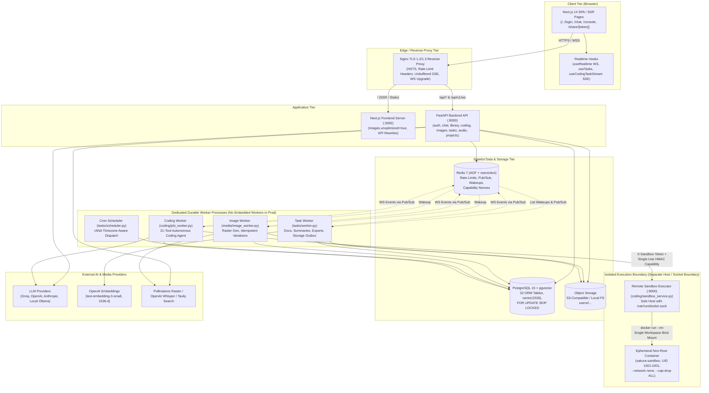

# Sakura AI — Overall System Architecture

This document defines the implemented high-level architecture and production deployment topology of **Sakura AI**, grounded directly in `anime-ai/docker-compose.prod.yml`, `anime-ai/ops/nginx.conf.example`, and `anime-ai/backend/main.py`.

---

## Diagram 1: Overall Sakura AI System Architecture

*Figure 1: Overall 10-service Sakura AI architecture showing strict separation between the stateless API, four independent worker processes, PostgreSQL 15 + `pgvector` authoritative state, Redis 7 coordination, and the isolated Docker sandbox execution boundary.*

---

## Service Responsibilities (`anime-ai/docker-compose.prod.yml`)

| Service | Entrypoint / Image | Primary Responsibility | Network / Security Boundary |
| --- | --- | --- | --- |
| `nginx` | `nginx.conf.example` | TLS termination, security headers, SSE proxy buffering off, WebSocket upgrade | Public edge; sets `X-Forwarded-For` trusted via `TRUSTED_PROXY_CIDRS` |
| `frontend` | `anime-ai/frontend/Dockerfile` | Next.js 14 React UI (`:3000`), `images.unoptimized=true` | Internal app network; no DB or Redis access |
| `backend` | `uvicorn main:app` (`:8000`) | REST APIs, SSE chat streaming, WebSocket hub, `/health` & `/readiness` | No Docker socket; fail-closed production startup guards |
| `worker` | `python -m tasks.worker` | Document parsing/embedding, scheduled runs, ZIP exports, storage deletion outbox | Lease-fenced DB claims + killable subprocess storage delete runner |
| `image-worker` | `python -m media.image_worker` | Raster image generation, prompt-context variations, library sync | Lease-fenced claims, idempotency key deduplication |
| `coding-worker` | `python -m coding.job_worker` | Autonomous repository coding loop & tool invocation | Calls `sandbox-executor` over HTTP; zero Docker socket access |
| `scheduler` | `python -m tasks.scheduler` | Polls `scheduled_tasks` with cron + IANA timezone evaluation | Enforces unique `(task_id, scheduled_for)` occurrence constraint |
| `sandbox-executor` | `python -m coding.sandbox_service` (`:9000`) | Sole service mounting `/var/run/docker.sock`; spawns non-root child containers | Requires `X-Sandbox-Token` + single-use HMAC capability for network commands |
| `postgres` | `pgvector/pgvector:pg15` | Authoritative relational + `vector(1536)` store (32 tables) | Internal network only; backed up via `backup_postgres.sh` |
| `redis` | `redis:7-alpine` (AOF, `noeviction`) | Rate limiting, worker wakeups, WS Pub/Sub, single-use capability nonces | Internal network only; fail-closed in production |
